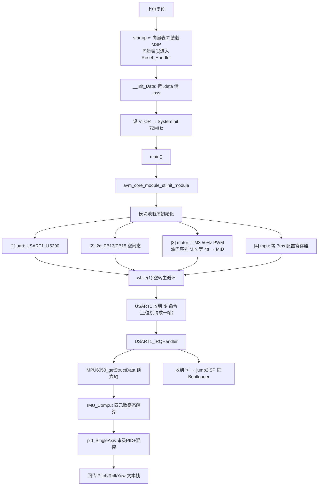
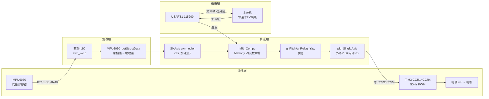

# Avem 源码详解 00：总览与硬件架构

> **涉及文件**（本文为全局索引，行号引用均来自当前工作区真实文件）：
> - `src/main.c`（45 行）—— 程序入口
> - `src/startup.c`（395 行）—— 上电启动代码
> - `libs/module/avm_core.c/.h`（111/70 行）—— 模块池机制
> - `libs/module/avm_i2c.c`（145 行）—— 软件 I2C 总线
> - `libs/module/avm_mpu6050.c/.h`（241/130 行）—— 六轴驱动 + 姿态解算
> - `libs/module/avm_pid.c/.h`（104/69 行）—— 串级 PID
> - `libs/module/avm_motor.c/.h`（92/76 行）—— TIM3 PWM 电机输出
> - `libs/module/avm_uart.c/.h`（177/39 行）—— USART1 链路（协议+控制触发）
> - `libs/module/avm_wifi.c/.h`（62/22 行）—— 预留 Wi-Fi 数传
> - `linker.ld`、`Makefile`、`docs/bomV2.0.csv` —— 构建/物料

---

## 1. Avem 是什么

Avem（https://github.com/but0n/Avem）是一个**约 1600 行自有代码**的 STM32 四轴飞控，
是"姿态解算 → 串级 PID → 电机混控"这条飞控主链路的**最小可读实现**：

| 维度 | Avem | 工程级飞控（Betaflight） |
| --- | --- | --- |
| 代码量 | 自有代码约 1600 行（`wc -l` 实测 src/+libs/module/） | 十万行级 |
| 操作系统 | 裸机（无 RTOS，中断驱动） | 裸机 + 精密任务调度 |
| 姿态解算 | Mahony 互补滤波（四元数，`IMU_Comput`） | Mahony/MEMS 融合 + 多传感器 |
| 传感器 | MPU6050 六轴（软件 I2C） | 多 IMU + 气压计 + 磁力计 |
| 电调协议 | 普通 PWM 50Hz | DShot300/600 数字协议 |
| 通信 | USART1 文本协议（'$' 触发） | MultiWii MSP/CRSF 全功能 |
| 代码风格 | 寄存器直写（无 HAL/StdPeriph 调用） | 分层驱动 |

自有代码只有 20 个文件（见上表），其中 `libs/STM32_USB-FS-Device_Lib_V4.0.0/` 是 ST
官方 USB 库（C 级，注释工程不动）。**读懂上面 10 个自有文件 = 读懂一个飞控的全部骨架。**

## 2. 硬件架构

### 2.1 核心器件（docs/bomV2.0.csv 实测）

| 器件 | 型号 | 作用 | 与固件的接口 |
| --- | --- | --- | --- |
| 主控 U2 | STM32F103RCT6（LQFP-64，64 引脚） | 飞控大脑，72MHz Cortex-M3 | — |
| IMU | MPU6050（模块外接，I2C 地址 0x68） | 三轴陀螺 + 三轴加速度 | 软件 I2C：PB13=SCL、PB14/15=SDA（见 `avm_i2c.h` 5~12 行） |
| 电机 ×4 | 空心杯电机 + 电调板 | 动力 | TIM3 四通道 PWM：PA6/PA7/PB0/PB1（`avm_motor.c` 51~65 行） |
| 串口 | USART1（PA9=TX、PA10=RX，`avm_uart.c` 39~40 行） | 上位机协议/控制触发 | 115200 8N1 |
| USB | USB-FS（ST 官方库预留虚拟串口） | 备用调试通道 | 库代码，本版未接主流程 |
| Wi-Fi（预留） | ESP8266（USART3：PB10/PB11） | 数传扩展 | AT 指令（`avm_wifi.c` 54~62 行） |
| 晶振 Y1 | 8MHz | HSE 倍频到 72MHz | SystemInit()（ST 库） |
| 电源 U1 | APE8865N-33（3.3V LDO） | 供电 | — |
| LED | LED0=PA8、LED1=PD2（`avm_mpu6050.h` 23~24 行） | 状态指示（I2C 故障灯） | 位带操作 |

> 接线兼容 Naze32 翻板布局：4 个 2P 端子（BOM 里 CONN_01X02 ×4）就是四路电机座。

### 2.2 时钟与外设账本（量化）

| 项 | 数值 | 来源 |
| --- | --- | --- |
| 系统主频 | 72MHz（HSE 8MHz ×PLL9） | `SystemInit()`（ST 库 startup 调用，`src/startup.c` 310 行） |
| SysTick 延时基频 | 9MHz（HCLK/8），9 tick = 1µs、9000 tick = 1ms | `avm_core.c` 52~60 行 |
| TIM3 计数时钟 | 72MHz / 40 = 1.8MHz | `motor_PWM_Init(36000,40)`（`avm_motor.h` 53~58 行宏展开） |
| PWM 频率 | 1.8MHz / 36000 = 50Hz（周期 20ms） | `avm_motor.c` 68~69 行：`ARR=35999, PSC=39` |
| 油门行程 | 1620~3600 计数 = 0.9ms~2ms | `avm_motor.h` 39~41 行 |
| I2C 速率 | 约 100kHz 量级（`delay_custom(1)` 每次 4 空转拍） | `avm_i2c.c` 36~39 行 |
| RAM/Flash | RAM 64K @0x20000000，Flash 256K @0x08000000，EEPROM 模拟 4K @0x0807F000 | `linker.ld` 9/13/21 行 |

### 2.3 内存地图（linker.ld）

| 区段 | 地址/位置 | 谁在用 |
| --- | --- | --- |
| `.isr_vectors` | Flash 0x08000000 起，0x80 对齐（`linker.ld` 29~35 行） | 向量表（`src/startup.c` 132~270 行） |
| `.text`/`.rodata` | Flash | 代码与常量；`_sidata = _etext`（`linker.ld` 85 行）是 .data 的装载地址 |
| `.data` | VMA 在 RAM，LMA 在 Flash（`linker.ld` 93~105 行 `>RAM AT>FLASH`） | 已初始化全局变量（如 `avm_pid`） |
| `.bss` | RAM（NOLOAD） | 未初始化全局变量（如 `g_Roll`、`avm_euler`） |
| 栈 | 向量表[0] = `_estack` = 0x20010000（RAM 末尾） | MSP 主栈，裸机单栈 |
| EEMUL | 0x0807F000（4K） | Flash 模拟 EEPROM，本版未用 |

## 3. 软件架构：一条"命令驱动的控制循环"

Avem 最大的架构特点：**主循环是空的**（`src/main.c` 43~44 行 `while(1){}`），
真正的一轮"采样→解算→PID→输出"由 **USART1 接收中断**里的 `'$'` 命令触发
（`avm_uart.c` 59~91 行）。即控制频率 = 上位机发 `$` 的频率——这是教学版与
正式飞控（定时器中断固定 500Hz~8kHz）最大的差别。

### 3.1 执行流全景

### 3.2 数据流全景

## 4. 模块池：一张表启动整个系统

`libs/module/avm_core.c` 76~83 行定义的 `avm_modules_pool[]` 是全系统的"工厂目录"：

| 槽位 | 模块实例 | init 做什么 | 依赖 |
| --- | --- | --- | --- |
| [0] | `avm_core_module_st` | 配置 NVIC 分组 + 统计模块数 + 逐个调用后续模块 | 自管理 |
| [1] | `avm_uart_module_st` | USART1 115200、PA9/PA10、RX 中断 | 无 |
| [2] | `avm_i2c_module_st` | PB13/PB15 GPIO 模拟 I2C，总线释放空闲 | 无 |
| [3] | `avm_motor_module_st` | TIM3 50Hz PWM + 上电油门序列（4s） | delay_ms |
| [4] | `avm_mpu_module_st` | 延时 7ms + MPU6050 寄存器配置 | i2c |
| 末尾 | `NULL` | 遍历哨兵 | — |

每个模块实现统一的 `avm_module_t` 接口（`avm_core.h` 46~52 行）：
`{index, confs, init_module, enable_module, disable_module}`——C 语言版插件接口。
细节精读见 [02-模块池与主循环.md](02-模块池与主循环.md)。

## 5. 文件索引（读码路径）

| 想理解什么 | 从哪里读 | 深读文章 |
| --- | --- | --- |
| 复位到 main 之前发生了什么 | `src/startup.c` 116~314 行 | [01-启动流程精读.md](01-启动流程精读.md) |
| 一张函数表如何启动全系统 | `avm_core.c` 76~111 行 | [02-模块池与主循环.md](02-模块池与主循环.md) |
| I2C 时序位带操作 | `avm_i2c.c` 61~145 行 | [03-MPU6050与软件I2C.md](03-MPU6050与软件I2C.md) |
| 六轴原始数据怎么变姿态角 | `avm_mpu6050.c` 121~241 行 | [03](03-MPU6050与软件I2C.md) / [04-姿态解算.md](04-姿态解算.md) |
| 四元数互补滤波推导 | `avm_mpu6050.c` 178~241 行 | [04-姿态解算.md](04-姿态解算.md) |
| PID 输出怎么变成电机差速 | `avm_pid.c` 56~104 行 | [05-串级PID.md](05-串级PID.md) / [06-电机PWM混控.md](06-电机PWM混控.md) |
| TIM3 寄存器级 PWM 配置 | `avm_motor.c` 46~92 行 | [06-电机PWM混控.md](06-电机PWM混控.md) |
| 上位机协议与调参 | `avm_uart.c` 27~177 行 | [07-链路通信与调参指南.md](07-链路通信与调参指南.md) |

## 6. 已知的口径问题（读码时注意，代码保持原样）

1. **加速度换算系数**：`MPU6050_getStructData`（`avm_mpu6050.c` 126~128 行）除以
   `1671.83f ≈ 16384/9.8`，是 **±2g 量程换算 m/s²** 的系数；而 `ACCEL_CONFIG`
   写入的是 `0x01`（±4g，8192 LSB/g）。两者口径不一致——但因为姿态解算
   `IMU_Comput` 第一步就把加速度向量**归一化**（187~193 行），绝对刻度对解算无影响。
2. **PWM 频率**：`motor_PWM_Init(36000,40)` 实际是 **50Hz**（20ms 周期），与
   THROTTLE_MAX=3600 计数 = 2ms 的电调行程自洽；`avm_motor.c` 44 行示例注释写
   "arr=100, psc=144 → 500Hz"，按公式实为 5000Hz，以公式为准。
3. **NMI 别名笔误**：`src/startup.c` 320 行 `#pragma weak MMI_Handler` 疑似
   `NMI_Handler` 笔误，NMI 表项实际为 0（弱声明未定义）。
4. **halfT 假设**：`avm_mpu6050.h` 109 行 `halfT=0.001` 隐含 500Hz 解算频率假设，
   实际解算由上位机 '$' 请求频率决定，失配时四元数积分速度成比例偏差。
5. **`avm_uart.h` TOKEN '$'**：控制循环由串口命令驱动，上位机不发 '$' 飞控就不
   解算——教学上直观，实用上必须由主机定频请求。

以上 5 处均为"记录现象、不改编译产物"的学习笔记；引用的行号可在对应 KB 条目核对。

## 7. 陷阱与实测建议

- 上电后**别急着碰飞控**：`MOTOR_SETTING`（`avm_motor.h` 52~58 行）设计上有
  `delay_ms(4000)` 的电调自检等待；但该值超出 SysTick 24 位计数上限会回卷成
  约 0.27 秒（推导见 02 篇"陷阱"），实测以电调提示音为准再上油门。
- 桌面调试务必**卸桨或架空**：`'$'` 命令会直接驱动电机，pid_SingleAxis 会真的写 CCR。
- I2C 无 ACK 时 LED1（PD2）常亮（`avm_mpu6050.c` 52~53 行），先查 SDA/SCL 接线。
- 想让飞控"自己转起来"（不依赖上位机），需要把 `USART1_IRQHandler` 里 62~82 行
  的控制段搬进 SysTick/TIM 定时中断——这正是从 Avem 进阶到正式飞控的第一课。

## 8. KB 逐函数精读条目（相对链接）

[src_main.md](../../../05-学习笔记与知识库/Knowledge-Base/avem/src_main.md) ·
[src_startup.md](../../../05-学习笔记与知识库/Knowledge-Base/avem/src_startup.md) ·
[libs_module_avm_core.md](../../../05-学习笔记与知识库/Knowledge-Base/avem/libs_module_avm_core.md) ·
[libs_module_avm_i2c.md](../../../05-学习笔记与知识库/Knowledge-Base/avem/libs_module_avm_i2c.md) ·
[libs_module_avm_mpu6050.md](../../../05-学习笔记与知识库/Knowledge-Base/avem/libs_module_avm_mpu6050.md) ·
[libs_module_avm_pid.md](../../../05-学习笔记与知识库/Knowledge-Base/avem/libs_module_avm_pid.md) ·
[libs_module_avm_motor.md](../../../05-学习笔记与知识库/Knowledge-Base/avem/libs_module_avm_motor.md) ·
[libs_module_avm_uart.md](../../../05-学习笔记与知识库/Knowledge-Base/avem/libs_module_avm_uart.md) ·
[libs_module_avm_wifi.md](../../../05-学习笔记与知识库/Knowledge-Base/avem/libs_module_avm_wifi.md)
