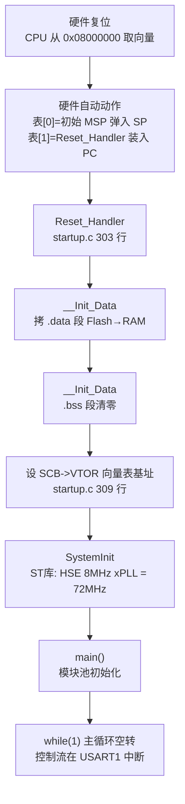
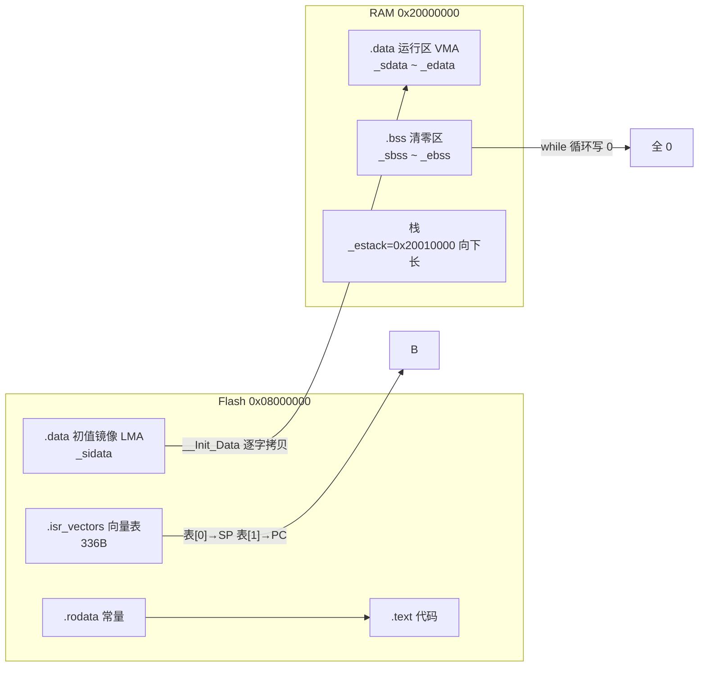

# Avem 源码详解 01：启动流程精读

> **涉及文件**：
> - `src/startup.c`（395 行）—— 启动代码本体
> - `linker.ld`（169 行）—— 提供启动所需的全部地址符号
> - `src/main.c`（45 行）—— 启动的终点

Cortex-M3 上电后到 `main()` 第一行之间发生的事，全部浓缩在这一个 C 文件里。
多数工程用汇编写启动文件（`startup_stm32f10x_hd.s`），Avem 用**纯 C** 重写——
向量表就是一个函数指针数组，`.data` 搬运就是一个 `while` 循环，反而更适合初学。

---

## 1. 启动全流程



上表每一步都对应到具体代码行。其中 B 步是**硬件行为**（无法用 C 修改），
C 步之后才是本文件的内容。

## 2. 向量表：一个 const 函数指针数组

### 2.1 结构定义（src/startup.c 132~134 行，逐字摘录）

```c
__attribute__ ((section(".isr_vectors")))
void (* const g_pfnVectors[])(void) = {
 (intfunc)((unsigned long)&_estack), /* The stack pointer after relocation */
 Reset_Handler,
```

三个要素：

| 要素 | 含义 | 设计意图 |
| --- | --- | --- |
| `__attribute__((section(".isr_vectors")))` | 把数组放进自定义段 | `linker.ld` 35 行 `KEEP(*(.isr_vectors))` 把它钉在 Flash 最前 |
| `void (* const [])（void)` | 只读函数指针数组 | `const` 让它落 Flash 不占 RAM |
| `intfunc` 类型转换（22 行 `typedef void( *const intfunc )( void );`） | 把"数据指针"伪装成函数指针 | 表[0] 存的是栈顶地址而非函数 |

### 2.2 表项账本（395 行文件中，表共 139 行：132~270 行）

| 表项索引 | 内容 | 实际行号 | 触发者 |
| --- | --- | --- | --- |
| [0] | `(intfunc)&_estack` = 0x20010000 | 134 行 | 硬件：装入 SP |
| [1] | `Reset_Handler` | 135 行 | 硬件：装入 PC |
| [2] | `NMI_Handler` | 137 行 | 内核 NMI |
| [3] | `HardFault_Handler` | 139 行 | 内核硬错误 |
| [4]~[6] | MemManage/BusFault/UsageFault | 141~145 行 | 内核错误（需启用） |
| [7]~[10] | 4 个保留 0 | 147~154 行 | — |
| [11]~[15] | SVC/DebugMon/PendSV/SysTick | 155~164 行 | RTOS 挂钩位（本工程未用） |
| [16]~[83] | 外设 IRQ0~IRQ67 | 166~258 行 | NVIC 外设 |
| [84+] | 0 填充 + `(intfunc)0xF1E0F85F` | 259~269 行 | RAM 启动预留 |

**量化**：外设表项 [16] 是 WWDG（166 行），对应 IRQ 编号 0；[83] 是
`DMA2_Channel4_5_IRQHandler`（258 行），IRQ 编号 67——正是 STM32F103 高容量
（HD）型号的 68 个外设中断。表总长 (68+16)×4 = 336 字节 = 0x150，这就是
`linker.ld` 34 行 `_isr_vectors_offs = . - 0x08000000` 的实体。

**关键设计：weak 兜底**。向量表里引用的 `WWDG_IRQHandler` 等函数在工程里没有
实现体，靠 315~388 行的 `#pragma weak X = Default_Handler` 别名兜住：

```c
#pragma weak USART1_IRQHandler		= Default_Handler
```

一旦任何 .c 文件写出强符号 `void USART1_IRQHandler(void)`（如 `avm_uart.c`
59 行就做了），别名自动失效、真实函数生效。**这是"不实现也不跑飞"的关键机制。**

> 注意 320 行第一句 `#pragma weak MMI_Handler = Default_Handler`：`MMI_Handler`
> 疑似 `NMI_Handler` 的笔误。NMI 只有 45 行的弱声明、没有定义也没有别名，
> 链接器把它解析为 0——NMI 表项实际是空指针。仅记录，不改代码。

## 3. __Init_Data：C 运行环境的物理基础

### 3.1 源码（src/startup.c 282~295 行，逐字摘录）

```c
void __Init_Data(void) {
	unsigned long *src, *dst;
	/* copy the data segment into ram */
	src = &_sidata;
	dst = &_sdata;
	/* src==dst 说明链接器把 .data 直接放进了 RAM（无需搬运），直接跳过 */
	if (src != dst)
		while(dst < &_edata)
			*(dst++) = *(src++);
	/* zero the bss segment */
	dst = &_sbss;
	while(dst < &_ebss)
		*(dst++) = 0;
}
```

### 3.2 六个符号从哪来（31~36 行声明，linker.ld 定义）

| 符号 | linker.ld 定义位置 | 值（本工程） | 物理意义 |
| --- | --- | --- | --- |
| `_sidata` | 85 行 `_sidata = _etext` | Flash 里 .rodata 之后的地址 | .data 的**装载地址**（LMA） |
| `_sdata`/`_edata` | 94/104 行 | RAM 段内 | .data 的**运行地址**（VMA）起止 |
| `_sbss`/`_ebss` | 109/116 行 | RAM 段内 | .bss 起止 |
| `_estack` | 25 行 `ORIGIN(RAM)+LENGTH(RAM)` | 0x20010000 | 栈顶（向下生长） |

`.data` 段 `>RAM AT>FLASH`（linker.ld 105 行）的写法就是"运行在 RAM、
存储在 Flash"的双地址布局——**没有 `__Init_Data` 的搬运，`unsigned int x = 42;`
这样的全局变量在 RAM 里就是随机垃圾**。

### 3.3 量化

- 逐 `unsigned long`（4 字节）搬运：`avm_pid`（pid_st 含 9 个 float/short 成员 +
  3 个指针 ≈ 56 字节）、`avm_uart_conf[2]` 等全部已初始化全局量一次性就位。
- `.bss` 清零对应 C 标准"静态存储期变量默认为 0"：`g_Roll/g_Pitch/g_Yaw`
  （`avm_mpu6050.c` 161 行）、`avm_euler`（162 行）上电即 0，不需要代码写 0。
- 时间开销：假设 .data+.bss 共 2KB，逐字循环约 512 次，主频 72MHz 下微秒级，
  对启动时间可忽略。

## 4. Reset_Handler：软件启动三部曲

### 4.1 源码（src/startup.c 303~314 行，逐字摘录）

```c
void Reset_Handler(void) {
	__Init_Data(); /* Initialize memory, data and bss */
	extern u32 _isr_vectors_offs; /* the offset to the vector table in ram */
	/* 设置向量表基址：VTOR 低 7 位恒为 0（要求 128 字对齐），
	 * 0x1FFFFF80 掩码即保留对齐位、清掉其它位。本工程向量表在 Flash，
	 * _isr_vectors_offs=0，结果即 0x08000000 */
	SCB->VTOR = 0x08000000 | ((u32)&_isr_vectors_offs & (u32)0x1FFFFF80); /* set interrupt vector table address */
	SystemInit(); /* configure the clock */
	main(); /* start execution of the program */
	/* main 返回即死等复位——裸机程序没有"退出"的概念 */
	while(1) {}
}
```

### 4.2 逐行解释

1. **`__Init_Data()`**（304 行）：先备好内存，后面任何全局变量访问才合法。
2. **VTOR 设置**（309 行）：`_isr_vectors_offs` 来自 linker.ld 34 行
   （`. = ALIGN(0x80)` 后的段内偏移）。Cortex-M3 的 VTOR 位[6:0] 保留，
   所以掩码 `0x1FFFFF80`——向量表必须 128 字节对齐，`linker.ld` 29 行的
   `ASSERT(ORIGIN(FLASH) == ALIGN(ORIGIN(FLASH), 0x80), ...)` 就是在链接期
   强制检查这一点。本工程向量表在 Flash 起点，offs=0，VTOR 最终 = 0x08000000。
3. **`SystemInit()`**（310 行）：ST 标准库函数（CMSIS `system_stm32f10x.c`），
   从 HSE 8MHz 起 PLL×9 = 72MHz，配 FLASH 等待周期。Makefile.common 82 行
   `-D VECT_TAB_FLASH` 决定它内部默认 VTOR 指向 Flash——与上一行手动设置一致。
4. **`main()`**（311 行）：进入应用。**为什么要 `extern int main(void)`（43 行）
   先声明**：Reset_Handler 在向量表里被引用，链接器要求符号先声明后使用。
5. **`while(1){}`**（313 行）：main 若返回，死等看门狗/复位。裸机没有 exit。

> `__attribute__((__interrupt__))`（39 行）：告诉 arm-none-eabi-gcc 该函数是
> 中断/异常入口，返回序列按中断语义生成（复位入口实际上永不返回，此属性更多
> 是防御性写法）。

## 5. .data 拷贝的地址流（对照 linker.ld）



（图中 B 为复位取向量动作；`DLMA --> DATAV` 即 288~290 行的 while 循环。）

## 6. 陷阱与实测建议

- **改向量表顺序必炸**：[16]~[83] 的外设顺序严格对应参考手册，`USART1` 在
  [53]（230 行，IRQ53）。挪动一位，所有中断全错位。
- **栈大小**：linker.ld 27 行 `_min_stack = 0x100` 只保证链接期检查，真正的栈
  是 `_estack` 向下与 .bss 末端自由竞争——Avem 调用深度浅（最深是 IMU_Comput
  的 float 运算 + printf 类字符串栈帧），但加递归代码要小心。
- **Weak 机制是双刃剑**：手滑写错函数名（如 `USARTl_IRQHandler` 用了小写 L），
  链接不报错、中断悄悄落进 Default_Handler 死循环。卡死时优先怀疑这里。
- **VTOR 的 0x80 对齐**：自定义段改名后忘了 `KEEP`，向量表被 --gc-sections
  回收，程序直接跑飞；`linker.ld` 35 行的 `KEEP` 不能删。
- **看启动代码的正确姿势**：`make dump`（Makefile 51~53 行）生成的 DUMP.s 里
  找 `0x08000000` 前几个字：第一个是 0x20010000（MSP），第二个是 Reset_Handler
  地址（thumb 位 1），可与本文账本逐项核对。

> KB 逐函数精读：[src_startup.md](../../../05-学习笔记与知识库/Knowledge-Base/avem/src_startup.md) ·
> [src_main.md](../../../05-学习笔记与知识库/Knowledge-Base/avem/src_main.md)
