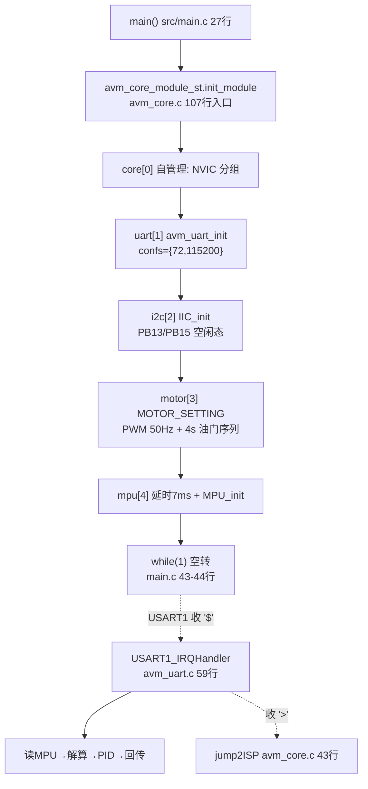
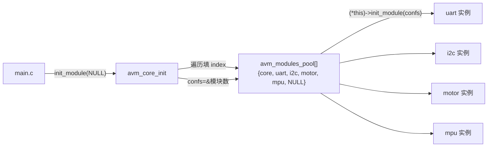

# Avem 源码详解 02：模块池与主循环

> **涉及文件**：
> - `libs/module/avm_core.h`（70 行）—— 模块接口协议定义
> - `libs/module/avm_core.c`（111 行）—— 模块池机制、SysTick 延时、jump2ISP
> - `src/main.c`（45 行）—— 唯一显式调用点

Avem 没有 RTOS、没有 main 里的初始化长清单。整个系统启动只需要一句
`avm_core_module_st.init_module(NULL)`（`src/main.c` 39 行）——背后是一张
**模块池函数表**在驱动。本文精读这张表的注册、编号、遍历机制，以及配套的
SysTick 阻塞延时和 Bootloader 跳转。

---

## 1. 模块接口协议（avm_module_t）

### 1.1 结构体定义（libs/module/avm_core.h 46~52 行，逐字摘录）

```c
struct avm_module_s {
    unsigned short  index;
    unsigned int    *confs;
    unsigned char   (*init_module)(void *arg);
    unsigned char   (*enable_module)(void);
    unsigned char   (*disable_module)(void);
};
```

| 字段 | 类型 | 含义 | 本工程实际使用 |
| --- | --- | --- | --- |
| `index` | unsigned short | 模块在池中的编号 | `avm_core_init` 第一遍遍历时填写 |
| `confs` | unsigned int* | 配置参数指针（void* 式万能用法） | uart 模块指向 `{72, 115200}`；core 指向模块个数 |
| `init_module` | 函数指针 | 初始化入口，统一签名 | **唯一真正被调用的钩子** |
| `enable_module` | 函数指针 | 运行期启用 | 全部为 NULL（预留） |
| `disable_module` | 函数指针 | 运行期停用 | 全部为 NULL（预留） |

**设计意图**：这是 C 语言模拟"面向对象插件接口"的最小写法——每个模块在
自己的 .c 里定义一个 `avm_module_t` 实例（相当于把 vtable 和对象合一），
core 只面向接口编程，不知道任何具体模块。对比 C++：`init_module ≈ 构造函数`。

### 1.2 各模块的接口实现（注册表）

| 模块 | 实例定义（行号） | init_module 指向 | confs 指向 |
| --- | --- | --- | --- |
| core | `avm_core.c` 30~36 行 | `avm_core_init` | 运行时指向模块个数 |
| uart | `avm_uart.c` 12~18 行 | `avm_uart_init` | `avm_uart_conf` = `{72, 115200}`（10 行） |
| i2c | `avm_i2c.c` 23~29 行 | `IIC_init` 的包装 | NULL |
| motor | `avm_motor.c` 26~32 行 | `MOTOR_SETTING` 宏的包装 | NULL |
| mpu | `avm_mpu6050.c` 27~33 行 | `MPU_init` 的包装（先延时 7ms） | NULL |

## 2. 模块池数组与初始化遍历

### 2.1 池定义（libs/module/avm_core.c 76~83 行，逐字摘录）

```c
avm_module_t *avm_modules_pool[] = {
	&avm_core_module_st,       /* [0] 核心（本文件，自管理） */
    &avm_uart_module_st,       /* [1] 串口（MultiWii 协议/调试输出） */
	&avm_i2c_module_st,        /* [2] 软件 I2C 总线 */
	&avm_motor_module_st,      /* [3] 四路电机 PWM（TIM3） */
	&avm_mpu_module_st,        /* [4] MPU6050 姿态传感器 */
    NULL
};
```

**顺序即依赖**：uart 最先（调试口就位后，后面初始化失败能打日志）→ i2c（mpu
的前置）→ motor（上电序列要 `delay_ms(4000)`，最长）→ mpu（依赖 i2c 与延时）。
末尾 `NULL` 是遍历哨兵——这是 C 数组遍历的惯用法，等价于字符串的 `\0`。

### 2.2 核心初始化函数（libs/module/avm_core.c 88~111 行，逐字摘录）

```c
static unsigned char avm_core_init(void *arg) {
	/* 设置 NVIC 中断优先级分组。0x07 是全部位都归抢占优先级；
	 * 减去 NVIC_GROUPING(3) 即留 3 位给子优先级（这是 CMSIS 函数的编码方式） */
	NVIC_SetPriorityGrouping(0x07 - NVIC_GROUPING);

	avm_module_t *p_core = avm_modules_pool[0];
	// Count
	/* 第一遍遍历：统计模块个数并给每个模块填 index 编号 */
	static unsigned char avm_modules_num = 0;
	for(;avm_modules_pool[avm_modules_num] != NULL;avm_modules_num++) {
		avm_modules_pool[avm_modules_num]->index = avm_modules_num;
	}

	p_core->confs = (void *)&avm_modules_num;	// Stored
	// Initial
	/* 第二遍遍历：从 [1] 开始（跳过 core 自己），逐个调用各模块的初始化函数。
	 * 注意变量名 this 只是普通指针名（C 里没有 C++ 的 this）。 */
	avm_module_t **this = &avm_modules_pool[1];
	for(;*this != NULL;this++) {
			(*this)->init_module((*this)->confs);
	}

	return 0;
}
```

### 2.3 逐段解释

1. **NVIC 分组**（91 行）：`NVIC_SetPriorityGrouping(0x07 - 3)` = 传入 4。
   在 STM32（优先级寄存器 4 位）语境下即"4 位抢占、0 位子优先级"——所有
   中断之间都能互相抢占，Avem 只有 USART1 一个使能中断，分组影响不大。
2. **第一遍遍历**（97~99 行）：数出 5 个模块（含 core），同时把 index 0~4
   写回各实例。`static` 让 `avm_modules_num` 保存在 .bss/.data，函数返回后
   仍在——`p_core->confs` 指向它，模块总数对全系统可见。
3. **第二遍遍历**（105~108 行）：`avm_module_t **this` 是"指向指针的指针"，
   `*this` 解引用得到模块实例指针，`(*this)->init_module(...)` 即调用该模块
   的初始化函数并把自己的 confs 传进去。**从 `[1]` 开始**跳过 core 自己，
   否则无限递归（core 的 init 会再调 core）。
4. **返回值**：统一 `unsigned char` 错误码约定，本工程各模块恒返回 0（未做
   错误传播——`MPU_init` 用 do-while 死等在位代替错误返回，见 `avm_mpu6050.c`
   104~113 行）。

## 3. SysTick 阻塞延时

### 3.1 毫秒延时（libs/module/avm_core.c 52~60 行，逐字摘录）

```c
void delay_ms(unsigned int t) {
	SysTick->LOAD = 9000 * t;      /* 装入倒计数值 */
	SysTick->VAL = 0;              /* 清零当前值（写任意值都会清 COUNTFLAG） */
	SysTick->CTRL = 0x01;          /* 使能 SysTick，时钟源 = HCLK/8（bit2=0），开始倒数 */
	/* 自旋等待：bit0=ENABLE 仍为 1 且 bit16(COUNTFLAG) 置位（计到 0）时退出 */
	for(unsigned int tmp = SysTick->CTRL;(tmp&0x01)&&(!(tmp&SysTick_CTRL_COUNTFLAG));tmp = SysTick->CTRL);
	SysTick->CTRL = 0;             /* 关闭 SysTick */
	SysTick->VAL = 0;              /* 清计数值 */
}
```

**量化**：SysTick 选外部时钟 HCLK/8 = 72MHz/8 = 9MHz（CTRL bit2=0）。
1ms = 9000 tick，所以 `LOAD = 9000 * t`。注意 24 位计数器上限 2^24-1 =
16777215 → `t ≤ 1864` ms，超出会溢出回卷（`delay_ms(2000)` 实际约 1864ms
后 COUNTFLAG 提前置位——隐患之一，见"陷阱"）。

`delay_us`（64~71 行）同构，`LOAD = 9 * t`，上限 `t ≤ 1864136` µs。

**阻塞语义**：两个延时都是死等 CPU，中断仍会照常打断（SysTick 中断未使能，
只有轮询 COUNTFLAG）。`MOTOR_SETTING` 里 `delay_ms(4000)` 就是纯烧 4 秒 CPU。

## 4. jump2ISP：软件触发串口烧录

### 4.1 源码（libs/module/avm_core.c 43~48 行，逐字摘录）

```c
void jump2ISP() {
	SysTick->CTRL = 0;                                   /* 1. 关闭 SysTick，防止跳转途中触发中断 */
	SysTick->VAL = 0;                                    /*    清空当前计数值 */
	__set_MSP(*(unsigned int *)ISP_ADDR);                /* 2. 把主栈指针 MSP 设为 Bootloader 区首 4 字节存的栈顶值 */
	((void (*)(void))*((unsigned int *)(ISP_ADDR + 4)))(); /* 3. 取该处第 2 个字（复位向量）并跳转执行 */
}
```

**原理**：STM32 出厂在系统存储器 0x1FFFF000 固化了 Bootloader（`ISP_ADDR`，
`avm_core.h` 67 行）。正常 BOOT0=0 时不会执行它。这三行代码手动完成
"假装从系统存储器启动"：

1. 关 SysTick——防止跳到 Bootloader 后残余定时器状态捣乱；
2. `__set_MSP`：把 0x1FFFF000 处的第一个字（Bootloader 的初始栈顶）装入 MSP；
3. 取第二个字（Bootloader 复位向量）强转函数指针直接跳转。

调用点在 `avm_uart.c` 83~86 行：上位机发 `>` 字符即触发。之后 PC 上的
stm32flash/dfu-util 就能重新烧录固件——**飞控不拆机升级的关键**。

## 5. 主循环与执行流



主循环空转的原因：教学版把控制节奏交给了上位机（见 07 篇）。若要独立运行，
把控制段放进 `delay_us` 驱动的定时轮询或 TIM 中断即可——模块池架构对此无感。

## 6. 模块池数据流



## 7. 陷阱与实测建议

- **`delay_ms` 上限 1864ms**：24 位 SysTick @9MHz 的天花板（2^24/9000 ≈ 1864）。
  超限不是"提前返回"而是**回卷截断**：`MOTOR_SETTING`（`avm_motor.h` 56 行）
  调 `delay_ms(4000)`，`LOAD = 9000×4000 = 36,000,000` 写入 24 位寄存器后截断为
  `36,000,000 mod 16,777,216 = 2,445,568` tick ≈ **0.27 秒**——电调自检等待远短于
  代码意图的 4s（多数电调仍能完成自检，实测时若电机没就绪先怀疑这里）。
- **`avm_modules_num` 是 static 局部变量**：第二次进 `avm_core_init`（本工程
  不会）会从 5 继续计数，池越界。单次启动没问题，封装成库时要注意。
- **`this` 变量名**：C 里合法但极易误导，C++ 化改造时必须改名。
- **core 也实现模块接口**：`avm_core_module_st` 的 `init_module` 指向自己内部
  函数——main 调用 `init_module` 时其实执行的是 `avm_core_init`，两遍遍历
  设计让"接口调用"与"业务实现"完全解耦。
- **enable/disable 留空**：想实现"飞行中关电机模块"，给这两个钩子填实现即可，
  不用动 core——这正是模块池模式的扩展点。

> KB 逐函数精读：[libs_module_avm_core.md](../../../05-学习笔记与知识库/Knowledge-Base/avem/libs_module_avm_core.md) ·
> [src_main.md](../../../05-学习笔记与知识库/Knowledge-Base/avem/src_main.md)
