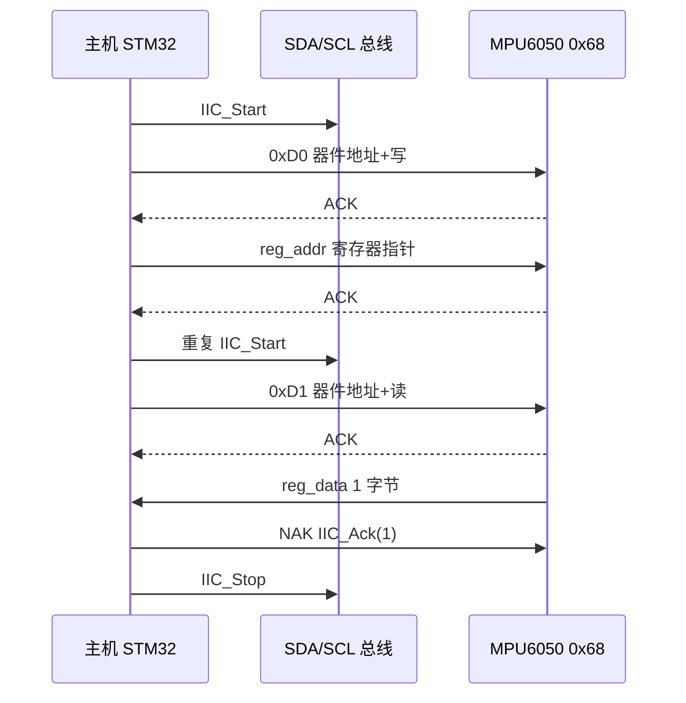
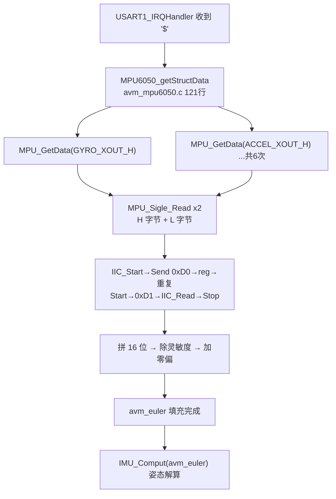
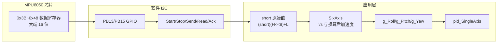

# Avem 源码详解 03：MPU6050 与软件 I2C

> **涉及文件**：
> - `libs/module/avm_i2c.c`（145 行）—— GPIO 模拟 I2C 时序（Start/Stop/Ack/收发）
> - `libs/module/avm_i2c.h`（32 行）—— SCL/SDA 位带宏（本文件未列入注释范围，KB 引用）
> - `libs/module/avm_bit.h`（7 行）—— 位带（bit-band）地址换算
> - `libs/module/avm_mpu6050.c`（241 行）—— 寄存器读写与六轴数据获取
> - `libs/module/avm_mpu6050.h`（130 行）—— 寄存器地图与零偏标定

用两个普通 GPIO 逐位翻转出 I2C 协议，再用它把 MPU6050 的六轴原始数据搬进内存
——这是嵌入式"从协议到物理层"最完整的一条学习路径。

---

## 1. 位带：为什么 `SDA = 1` 能操作一个引脚

### 1.1 位带宏（libs/module/avm_i2c.h 5~12 行，逐字摘录）

```c
#define SCL_PINNUM 15
#define SDA_PINNUM 14
#define SCL BIT_ADDR(&(GPIOB->ODR), SCL_PINNUM)
#define SDA BIT_ADDR(&(GPIOB->ODR), SDA_PINNUM)
//#define AD0 BIT_ADDR((GPIOC_BASE+12), 6)

#define READ_SDA BIT_ADDR(&(GPIOB->IDR), SDA_PINNUM)
```

### 1.2 位带地址换算（libs/module/avm_bit.h 4~5 行，逐字摘录）

```c
#define BITBAND(addr, bitnum) (((addr) & 0xF0000000) + 0x2000000 + (((addr) & 0xFFFFF) << 5) + ((bitnum)<<2))
#define BIT_ADDR(addr, bitnum) *((volatile unsigned long *)(BITBAND((unsigned int)(addr), bitnum)))
```

Cortex-M3 把 SRAM/外设区的每一位映射到"位带别名区"的一个 32 位字：
`别名地址 = 区域基址 + 0x2000000 + (字节偏移×32) + (位号×4)`。写这个字
等效于原子地写那一位。以 SDA 为例：`&GPIOB->ODR` = 0x40010C0C，
bit14 → 别名地址 = 0x40000000+0x2000000+ (0xC0C×32) + 14×4 = 0x4201 8358。
于是 `SDA = 1` 就是一次 32 位写，**免去"读-改-写-回"三步和竞态**。

> 注释与代码的口径差（仅记录，不改代码）：宏定义 `SCL_PINNUM=15`、
> `SDA_PINNUM=14`，`IIC_init` 里 `0x77000000` 也正是把 **PB14/PB15** 配成
> 0x7（CRH 每引脚 4 位，bits[31:28]=pin15、bits[27:24]=pin14）——代码层面
> 自洽：**SCL=PB15、SDA=PB14**。而 `avm_i2c.c` 文件头导读注释写的
> "PB13=SCL、PB15=SDA" 与之不符，接线时以宏定义与逻辑分析仪实测为准。

### 1.3 开漏与"好的 Bug"（libs/module/avm_i2c.c 42~58 行节选，逐字摘录）

```c
void IIC_init() {
    RCC->APB2ENR |= RCC_APB2ENR_IOPBEN;       //GPIOB enable
    GPIOB->CRH &= 0x00FFFFFF;   //reset B13 & B15
    GPIOB->CRH |= 0x77000000;   //Set B13 & B15 b0111
    SDA = 1;
    SCL = 1;
```

CRH 管理引脚 8~15，每引脚 4 位：`0x7` = 输出模式、开漏、50MHz。作者在
49~52 行的原始注释解释了为什么选开漏：开漏输出时输入通路保持畅通，
**随时能读 IDR**，不用在"输出/输入"之间来回切换方向——这正是软件 I2C
读从机 ACK 的刚需（标准 I2C 总线也要求开漏+上拉以支持线与）。

## 2. I2C 五原语逐行精读

I2C 时序速记：空闲双高；SCL 高时 SDA 下降沿=Start、上升沿=Stop；
SCL 高期间 SDA 必须稳定；第 9 个时钟收 ACK。

### 2.1 Start 与 Stop（libs/module/avm_i2c.c 61~80 行，逐字摘录）

```c
void IIC_Start() {
    SDA = 1;      /* 先确保两线都为高（空闲态起点） */
    SCL = 1;
    IIC_DELAY();
    SDA = 0;      /* SDA 先拉低 —— Start 的标志动作 */
    IIC_DELAY();
    SCL = 0;      /* SCL 再拉低，总线进入"数据传输预备"状态 */
}

/* 停止信号：SCL 高电平期间 SDA 产生上升沿（与 Start 相反） */
void IIC_Stop() {
    SCL = 0;
    IIC_DELAY();
    SDA = 0;      /* 先把 SDA 拉低，制造"低→高"的条件 */
    IIC_DELAY();
    SCL = 1;      /* 抬高 SCL */
    IIC_DELAY();
    SDA = 1;      /* SCL 高时 SDA 上升沿 = Stop */
    IIC_DELAY();
}
```

`IIC_DELAY()` = `delay_custom(1)`（`avm_i2c.h` 14 行），即 `avm_i2c.c` 37~39 行
的 4 次空转循环，72MHz 下约 1µs 量级——决定了 SCL 周期约 2~3µs（约 300~500kHz，
偏快但 MPU6050 支持 400kHz 快速模式）。**每一拍之间的 `IIC_DELAY()` 就是
软件 I2C 的"时序教科书"**：先放数据、再抬时钟、让从机采样、再落时钟。

### 2.2 发送与接收（libs/module/avm_i2c.c 116~145 行，逐字摘录）

```c
void IIC_Send(unsigned char dat) {
    unsigned char i;
    SCL = 0;
    for(i = 0; i < 8; i++) {
        IIC_DELAY();
        SDA = (dat&0x80)>>7;   /* 取最高位放到 SDA */
        dat <<= 1;             /* 左移，准备下一位 */
        IIC_DELAY();
        SCL = 1;               /* SCL 高：从机采样当前位 */
        IIC_DELAY();
        SCL = 0;               /* SCL 低：允许换下一位 */
    }
}
```

`IIC_Read`（132~145 行）镜像对称：先 `SDA=1` 释放总线，SCL 拉高后
`dat = (dat<<1) | READ_SDA` 逐位拼装。**MSB first** 是 I2C 协议规定。

### 2.3 ACK 三态（libs/module/avm_i2c.c 83~112 行）

| 函数 | 方向 | 关键动作 | 返回/含义 |
| --- | --- | --- | --- |
| `IIC_Ack(ack)` 83~92 行 | 主机→从机 | ack=0 拉低 SDA 应答，ack=1 保持高 NAK | 读最后一个字节后主机回 NAK |
| `IIC_Wait_Ack()` 97~112 行 | 主机等从机 | 释放 SDA，第 9 个时钟读回 | 1=收到 ACK；0=无应答 |
| 调用约定 | — | `avm_mpu6050.c` 52 行 `if(!IIC_Wait_Ack()) LED1=1` | 无应答点亮 PD2 故障灯 |

## 3. MPU6050 寄存器地图（avm_mpu6050.h 12~51 行）

| 寄存器 | 地址 | 写入值（MPU_init） | 效果 |
| --- | --- | --- | --- |
| `PWR_MGMT_1` | 0x6B | 0x00 | 退出睡眠（上电默认睡眠，不写则传感器无输出） |
| `SMPLRT_DIV` | 0x19 | 0x07 | 内部采样 1kHz/(1+7) = 125Hz 输出分频 |
| `CONFIG` | 0x1A | 0x06 | DLPF 最重滤波（陀螺 5Hz 带宽，输出最平滑、延迟最大） |
| `GYRO_CONFIG` | 0x1B | 0x18 | 满量程 ±2000°/s（灵敏度 16.4 LSB/(°/s)） |
| `ACCEL_CONFIG` | 0x1C | 0x01 | 满量程 ±4g（8192 LSB/g；A2A1A0=001） |
| `ACCEL_XOUT_H` | 0x3B~0x40 | 只读 | 三轴加速度，每轴 H+L 两字节，大端 |
| `GYRO_XOUT_H` | 0x43~0x48 | 只读 | 三轴角速度，同上 |
| `WHO_AM_I` | 0x75 | 只读 | 恒 0x68，在位探针 |

## 4. 一次完整的寄存器读（复合格式）

`MPU_Sigle_Read`（libs/module/avm_mpu6050.c 68~85 行，逐字摘录）：

```c
unsigned char MPU_Sigle_Read(unsigned reg_addr) {
    unsigned char reg_data;
    IIC_Start();
    IIC_Send(MPU6050_ADDR);          /* 器件地址+写位（先定寄存器指针） */
    IIC_Wait_Ack();

    IIC_Send(reg_addr);
    IIC_Wait_Ack();

    IIC_Start();                     /* 重复 START：切换读方向 */
    IIC_Send(MPU6050_ADDR+1);        /* 器件地址+读位（最低位 1 = 读） */
    IIC_Wait_Ack();

    reg_data = IIC_Read();           /* 读 1 字节 */
    IIC_Ack(1);
    IIC_Stop();
    return reg_data;
}
```

I2C 读随机寄存器必须"**先写后读**"：第一段写相（地址 0xD0）把内部寄存器
指针拨到 reg_addr；然后**不发 Stop、直接重复 Start**，第二段以读方向（0xD1）
取回数据。`IIC_Ack(1)` 是主机回 NAK——读收尾的标准动作。



## 5. 数据获取链：原始值 → 物理量

### 5.1 16 位拼接（libs/module/avm_mpu6050.c 88~93 行，逐字摘录）

```c
short MPU_GetData(unsigned char REG_Addr) {
    unsigned char H, L;
    H = MPU_Sigle_Read(REG_Addr);
    L = MPU_Sigle_Read(REG_Addr+1);
    return (short)(H<<8)+L;          /* 拼成 16 位有符号数（二进制补码） */
}
```

### 5.2 换算与零偏（libs/module/avm_mpu6050.c 121~140 行，逐字摘录）

```c
void MPU6050_getStructData(pSixAxis cache) {
    cache->gX = (float)MPU_GetData(GYRO_XOUT_H)/16.4f;
    cache->gY = (float)MPU_GetData(GYRO_YOUT_H)/16.4f;
    cache->gZ = (float)MPU_GetData(GYRO_ZOUT_H)/16.4f;

    cache->aX = (float)MPU_GetData(ACCEL_XOUT_H)/1671.83f;
    cache->aY = (float)MPU_GetData(ACCEL_YOUT_H)/1671.83f;
    cache->aZ = (float)MPU_GetData(ACCEL_ZOUT_H)/1671.83f;

#ifdef IMU_SOFTWARE_FIXED
    /* 软件校零：把实测零偏加回去（数值在 avm_mpu6050.h，静止放置标定所得） */
    cache->gX += G_X_OFFSET;
    cache->gY += G_Y_OFFSET;
    cache->gZ += G_Z_OFFSET;

    cache->aX += A_X_OFFSET;
    cache->aY += A_Y_OFFSET;
    cache->aZ += A_Z_OFFSET;
#endif
}
```

- 陀螺：±2000°/s 挡灵敏度 16.4 LSB/(°/s)，除之得 °/s。
- 加速度：除数 1671.83 ≈ 16384/9.8（±2g 换算 m/s² 的系数），与 ACCEL_CONFIG
  实际写入的 ±4g 挡**口径不一致**——但下游 `IMU_Comput` 第一件事就是向量
  归一化，绝对刻度被约掉，姿态解算不受影响（量化推导见 04 篇）。
- 零偏（`avm_mpu6050.h` 72~79 行）：陀螺 X/Y/Z = 1.5853/0.7926/2.0121 °/s，
  加速度 Z = 0.2f——上电静置均值，符号为"加回"是因为读数 = 真值 + 偏差
  的取号约定（这套偏移来自作者手中那颗芯片，**换芯片必须重标**）。

### 5.3 在位自检（libs/module/avm_mpu6050.c 104~113 行，逐字摘录）

```c
void MPU_init() {
    IIC_init();
    do {
        MPU_Sigle_Write(PWR_MGMT_1, 0x00);
        MPU_Sigle_Write(SMPLRT_DIV, 0x07);
        MPU_Sigle_Write(CONFIG, 0x06);
        MPU_Sigle_Write(GYRO_CONFIG, 0x18);
        MPU_Sigle_Write(ACCEL_CONFIG, 0x01);
    } while(IMU_NOT_CONNECTED);      /* WHO_AM_I != 0x68 就一直重试 */
}
```

`IMU_NOT_CONNECTED` 是宏（`avm_mpu6050.h` 83 行）：
`(MPU_Sigle_Read(WHO_AM_I)!=IMU_ADDRESS)`——配置一轮后回读 WHO_AM_I，
不是 0x68 就整轮重来。传感器插反/虚接时系统会**卡在这里直到插好**，
配合 52~53 行的 LED1 故障灯构成最朴素的"自诊断"。

## 6. 执行流与数据流

### 6.1 执行流（一次 '$' 请求内的读取链）



### 6.2 数据流（从硅片到控制）



## 7. 陷阱与实测建议

- **接线以宏为准**：代码自洽为 SCL=PB15、SDA=PB14（详见 1.2 节口径差说明），
  与部分旧文档写的 PB13/PB15 不同。接模块时先跑通 WHO_AM_I 再定案，
  逻辑分析仪一眼定案。
- **速率偏快**：`IIC_DELAY()` 只有 1µs 拍，杜邦线长、上拉弱时容易读数毛刺，
  可把 `delay_custom` 的系数从 4 调到 8/16 降速验证。
- **单字节读效率低**：`MPU_GetData` 对每个物理量走两趟复合格式读（H/L 分开），
  一次六轴要 12 趟 I2C 事务。MPU6050 支持突发读（0x3B 起连续 14 字节），
  升级空间在这里。
- **睡眠陷阱**：忘记写 `PWR_MGMT_1=0`，读回恒 0 且 WHO_AM_I 正常——"在位但不
  出数"的经典故障。
- **零偏再标定**：换板/换芯片后把旧 OFFSET 宏清零，静置 30s 记录均值再回填；
  Yaw 轴零偏通常最大（本机 2.0121°/s，每分钟漂约 120°，不补则航向一路歪）。

> KB 逐函数精读：[libs_module_avm_i2c.md](../../../05-学习笔记与知识库/Knowledge-Base/avem/libs_module_avm_i2c.md) ·
> [libs_module_avm_mpu6050.md](../../../05-学习笔记与知识库/Knowledge-Base/avem/libs_module_avm_mpu6050.md)
