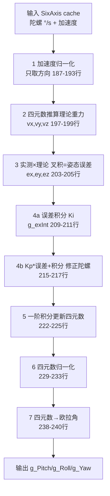
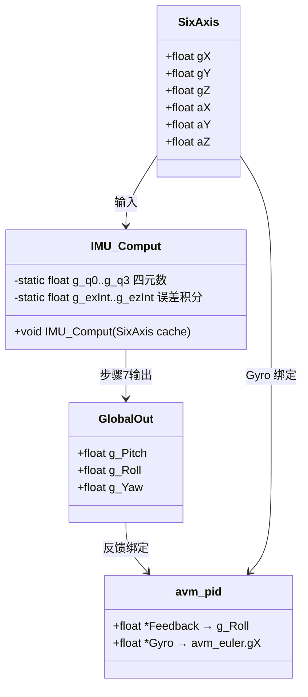
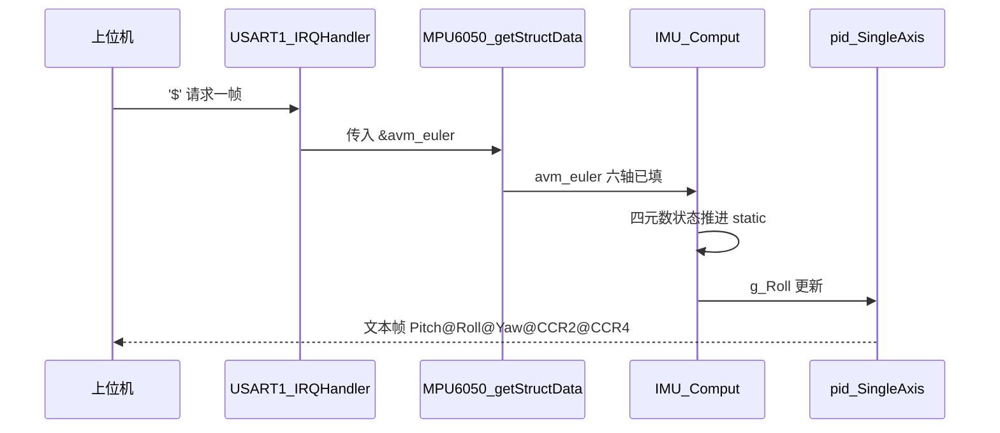
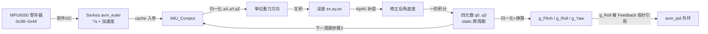

# Avem 源码详解 04：姿态解算（Mahony 补偿滤波）

> **涉及文件**：
> - `libs/module/avm_mpu6050.c` 159~241 行 —— `IMU_Comput()` 全部算法
> - `libs/module/avm_mpu6050.h` 101~109 行 —— Kp/Ki/halfT 参数
> - `libs/module/avm_mpu6050.c` 121~140 行 —— 上游数据 `MPU6050_getStructData`

`IMU_Comput()` 是 Avem 的灵魂：把"陀螺仪积分"与"加速度计重力方向"用四元数
融合成稳定姿态。全文 62 行，浓缩了 Mahony 互补滤波的全部核心思想——
**陀螺仪高频可信、加速度计低频可信，两者互补**。

---

## 1. 为什么需要"融合"，为什么用四元数

| 传感器 | 短期表现 | 长期表现 | 结论 |
| --- | --- | --- | --- |
| 陀螺仪（角速度积分得角度） | 平滑、灵敏 | 漂移（零偏积分，每分钟可漂几十度） | 信它高频 |
| 加速度计（测重力方向得倾角） | 噪声大、运动加速度污染 | 均值指向重力，长期可信 | 信它低频 |

**互补滤波**：`姿态 = 陀螺积分 + Kp×(加速度计纠偏)`——高通信陀螺、低通信
加速度计，Kp 决定分频点。Mahony 的改进是把纠偏量做成 PI 控制器（多一个
积分项消恒定漂移），且全程在**四元数**域进行。

**为什么不用欧拉角**：欧拉角在 Pitch=±90° 处遇到万向节锁（一个自由度丢失），
积分更新要处理非线性奇点。四元数 4 个数描述刚体旋转、无奇点、微分方程
是线性双曲函数，代价只是最后要归一化。

## 2. 算法总览（7 步）



## 3. 逐行精读

### 3.1 状态与输入（libs/module/avm_mpu6050.c 178~185 行，逐字摘录）

```c
void IMU_Comput(SixAxis cache) {
	static float g_q0 = 1, g_q1 = 0, g_q2 = 0, g_q3 = 0;   //Quaternion  /* 四元数，初始=单位四元数（水平姿态） */
	static float g_exInt = 0, g_eyInt = 0, g_ezInt = 0;    /* PI 补偿的误差积分项（static 跨周期保留） */

    float norm;     //模
    float vx, vy, vz;    /* 由四元数估计的重力方向分量 */
    float ex, ey, ez;    /* 叉积得到的姿态误差分量 */
```

- 四元数记 `q = q0 + q1·i + q2·j + q3·k`，`q0` 是标量部。初始 `(1,0,0,0)` =
  单位四元数 = 机体系与惯性系重合（水平静止）。
- 三个 `static`：**四元数和误差积分是算法的记忆**，跨调用持续演化——
  这就是"滤波器状态"。函数无锁：只被 USART1 中断单点调用（`avm_uart.c`
  64~65 行），不存在并发问题。

### 3.2 步骤 1：加速度归一化（187~193 行）

```c
    norm = sqrt(cache.aX*cache.aX + cache.aY*cache.aY + cache.aZ*cache.aZ);     //取模

    //向量化
    /* 步骤1：加速度归一化——加速度计只信"方向"，幅值受运动加速度污染不可信 */
    cache.aX = cache.aX / norm;
    cache.aY = cache.aY / norm;
    cache.aZ = cache.aZ / norm;
```

归一化后 `(aX,aY,aZ)` 是单位向量 = 纯方向。这一步**顺带消掉了上游换算系数的
一切口径问题**（±2g/±4g、g 还是 m/s² 都无所谓）——见 03 篇 5.2 节的 errata。
隐患：静止时 norm≈1g 无碍；自由落体/强震动时 norm→0 会除零，本实现未防护。

### 3.3 步骤 2：由四元数推算理论重力（195~199 行）

```c
    //估计方向的重力
    /* 步骤2：由当前四元数算出"机体系下的重力分量"（四元数旋转矩阵相关项） */
    vx = 2 * (g_q1 * g_q3 - g_q0 * g_q2);
    vy = 2 * (g_q0 * g_q1 + g_q2 * g_q3);
    vz = g_q0*g_q0 - g_q1*g_q1 - g_q2*g_q2 + g_q3*g_q3;
```

**推导**：把惯性系单位重力向量 `(0,0,1)` 用四元数旋转到机体系，得到旋转变换
矩阵 R 的第三列（重力在机体系的投影）：

```
R(1,3) = 2(q1q3 - q0q2)        → vx
R(2,3) = 2(q0q1 + q2q3)        → vy
R(3,3) = 1 - 2(q1² + q2²)      → vz   （与 q0²-q1²-q2²+q3² 等价，因 q0²+q1²+q2²+q3²=1）
```

水平静止时 `q=(1,0,0,0)` → `(vx,vy,vz)=(0,0,1)`：重力沿机体系 Z 轴，自洽。
`vx,vy,vz` 的物理意义是"**如果姿态估计是对的，加速度计应该测到这样的方向**"。

### 3.4 步骤 3：叉积求姿态误差（201~205 行）

```c
    //错误的领域和方向传感器测量参考方向几件的交叉乘积的总和
    /* 步骤3：实测重力 × 估计重力 的叉积 = 当前姿态误差向量（哪边歪了、歪多少） */
    ex = (cache.aY * vz - cache.aZ * vy);
    ey = (cache.aZ * vx - cache.aX * vz);
    ez = (cache.aX * vy - cache.aY * vx);
```

两个单位向量的叉积 `ā × v̂` = 旋转轴 × sin(夹角)：方向指出"绕哪根轴转能
从估计姿态转到实测姿态"，模长近似角度误差（小角度时 sinθ≈θ）。
- `ex,ey` 来自 roll/pitch 方向的重力失配；
- `ez` 是绕 Z 轴的失配——**没有磁力计时 ez 只有噪声贡献**，其积分会让
  Yaw 缓慢漂移（见 3.8 的输出说明），这是六轴 IMU 的物理极限而非 bug。

### 3.5 步骤 4：PI 补偿（207~217 行）

```c
    //积分误差比例积分增益
    /* 步骤4a：误差积分（Ki 项）——慢慢消除陀螺仪的恒定漂移 */
    g_exInt += ex * Ki;
    g_eyInt += ey * Ki;
    g_ezInt += ez * Ki;

    //调整后的陀螺仪测量
    /* 步骤4b：用 Kp*误差 + 积分项 修正陀螺仪读数——"信陀螺，但被加速度计拉着走" */
    cache.gX += Kp * ex + g_exInt;
    cache.gY += Kp * ey + g_eyInt;
    cache.gZ += Kp * ez + g_ezInt;
```

这是 Mahony 的"补偿控制器"：把姿态误差**当作角速度误差**喂给陀螺读数：

| 项 | 系数 | 作用 | 过大的后果 |
| --- | --- | --- | --- |
| P | Kp=100.0f | 快速拉回，决定"信任加速度计"的带宽 | 加速度计噪声直通姿态，机架一震就抖 |
| I | Ki=0.002f | 慢速消除恒定漂移（陀螺零偏） | 收敛慢；过大致低频振荡 |

量化：Kp=100 意味着 1 rad 量级的姿态失配会给角速度叠加 100°/s 的修正——
收敛非常快；Ki=0.002 则要几百个周期才累积出 1°/s 量级的偏置补偿。

### 3.6 步骤 5：四元数微分方程一阶积分（219~225 行）

```c
    //整合四元数率和正常化
    /* 步骤5：四元数微分方程一阶积分（halfT=采样周期一半，见 avm_mpu6050.h）。
     * 物理含义：按修正后的角速度把姿态"推"进一步 */
    g_q0 += (-g_q1 * cache.gX - g_q2 * cache.gY - g_q3 * cache.gZ) * halfT;
    g_q1 += (g_q0 * cache.gX + g_q2 * cache.gZ - g_q3 * cache.gY) * halfT;
    g_q2 += (g_q0 * cache.gY - g_q1 * cache.gZ + g_q3 * cache.gX) * halfT;
    g_q3 += (g_q0 * cache.gZ + g_q1 * cache.gY - g_q2 * cache.gX) * halfT;
```

理论来源是四元数运动学微分方程 `q̇ = ½ · q ⊗ ω`（ω 为机体系角速度四元数
展开），写成标量形式即上面 4 行；`halfT = 采样周期/2` 正是那个 ½ 系数
（`avm_mpu6050.h` 109 行 `halfT=0.001f` → 假设 2ms/500Hz 解算周期）。

> **经典小 bug（记录不改）**：4 行右侧用的 `g_q0/g_q1/...` 会在本轮被左端
> 更新（先算 q0 后，q1 的式子里 g_q0 已是新值）——严格欧拉积分应先用旧值。
> 500Hz 下每步误差 O(h²) 很小，实际影响有限，但换到低频调用时会放大。

**单位陷阱**：角速度必须是 **rad/s** 才与 `halfT`（秒）匹配。上游给的是 °/s，
等价于把 Kp/halfT 的隐含单位一起缩放（57.3 倍）——参数是作者配套调好的，
**单独改采样率或单位时必须联动重调**。

### 3.7 步骤 6：归一化（227~233 行）

```c
    //正常化四元
    /* 步骤6：单位四元数必须保持模长=1（浮点误差会让它漂移），除以模长 */
    norm = sqrt(g_q0*g_q0 + g_q1*g_q1 + g_q2*g_q2 + g_q3*g_q3);
    g_q0 = g_q0 / norm;
    g_q1 = g_q1 / norm;
    g_q2 = g_q2 / norm;
    g_q3 = g_q3 / norm;
```

旋转四元数必须保持模长 1，否则旋转变换会"缩放"空间。每步积分引入的浮点
误差和补偿量都会破坏模长，这里每周期强制拉回。

### 3.8 步骤 7：四元数 → 欧拉角（235~241 行）

```c
    /* 步骤7：四元数 → 欧拉角。
     * Pitch 用 asin（范围±90°），Roll/Yaw 用 atan2（全范围）。
     * 注意：没有磁力计时 Yaw 会缓慢漂移（表现为机头慢慢歪），属正常现象 */
    g_Pitch = asin(-2 * g_q1 * g_q3 + 2 * g_q0 * g_q2) * 57.3;
    g_Roll = atan2(2 * g_q2 * g_q3 + 2 * g_q0 * g_q1, -2 * g_q1*g_q1 - 2 * g_q2*g_q2 + 1) * 57.3;
    g_Yaw = atan2(2 * (g_q1 * g_q2 + g_q0 * g_q3), g_q0*g_q0 + g_q1*g_q1 - g_q2*g_q2 - g_q3*g_q3) * 57.3;
```

标准 ZYX（yaw-pitch-roll）旋转矩阵反解：

| 欧拉角 | 公式 | 值域 | 奇点 |
| --- | --- | --- | --- |
| Pitch | `asin(-2q1q3 + 2q0q2)` | ±90° | asin 在 ±90° 导数无穷大（万向节锁仍在，只是被推迟） |
| Roll | `atan2(2q2q3+2q0q1, 1-2(q1²+q2²))` | ±180° | 无 |
| Yaw | `atan2(2(q1q2+q0q3), q0²+q1²-q2²-q3²)` | ±180° | 无 |

`57.3 ≈ 180/π` 完成 rad→度。**g_Roll 立即被 PID 消费**：`avm_pid.c` 45 行
`.Feedback = &g_Roll`——姿态解算与控制环通过这个全局变量对接。

## 4. 类视角与执行时序





## 5. 数据流：从原始六轴到电机增量



四元数状态 `q0..q3` 与误差积分 `g_exInt..` 是**有向环**：每个周期输出姿态，
同时把自己推进一小步——滤波器是"活"的，这正是 3.1 节 static 的意义。

## 6. 陷阱与实测建议

- **调用频率决定 halfT 正确性**：halfT=0.001 假设 500Hz。本工程解算由上位机
  '$' 驱动，若 100Hz 请求则四元数推进速度只有真实角速度的 1/5——姿态
  "追不上"真实动作。上位机请求频率务必恒定。
- **加速度不可信期**：起飞/机动时运动加速度污染重力方向，Kp=100 会把噪声
  直接吸进姿态。工程做法是"加速度模长偏离 1g 越多，权重越低"——Avem 未做，
  是进阶改造点。
- **Yaw 必漂**：六轴无法观测航向绝对角，ez 误差无真实参考。需要航向保持就
  加磁力计（HMC5883L）做成九轴 Mahony。
- **除零风险**：步骤 1 的 `norm` 在加速度全零（I2C 读失败返回 0）时为 0，
  产生 NaN 并污染四元数。实测"姿态突然全 NaN 卡死"先查 I2C。
- **调 Kp/Ki 的顺序**：先固定 Ki=0 调 Kp 到"静止时姿态曲线最平、敲击后最快
  回稳"，再加小 Ki 消漂移；Kp 过大的标志是桌面静置也高频抖。
- **读码路径**：03 篇（数据从哪来）→ 本文（数据怎么变成角度）→
  [05-串级PID.md](05-串级PID.md)（角度怎么变成电机差速）。

> KB 逐函数精读：[libs_module_avm_mpu6050.md](../../../05-学习笔记与知识库/Knowledge-Base/avem/libs_module_avm_mpu6050.md)
