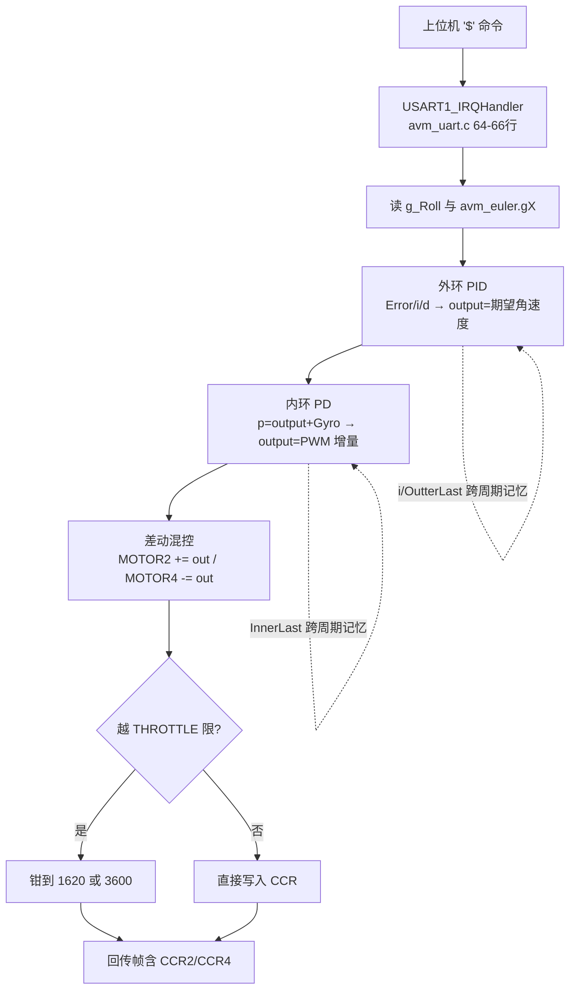
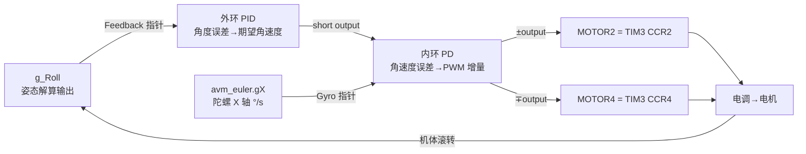
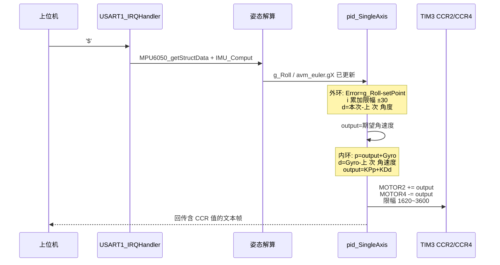
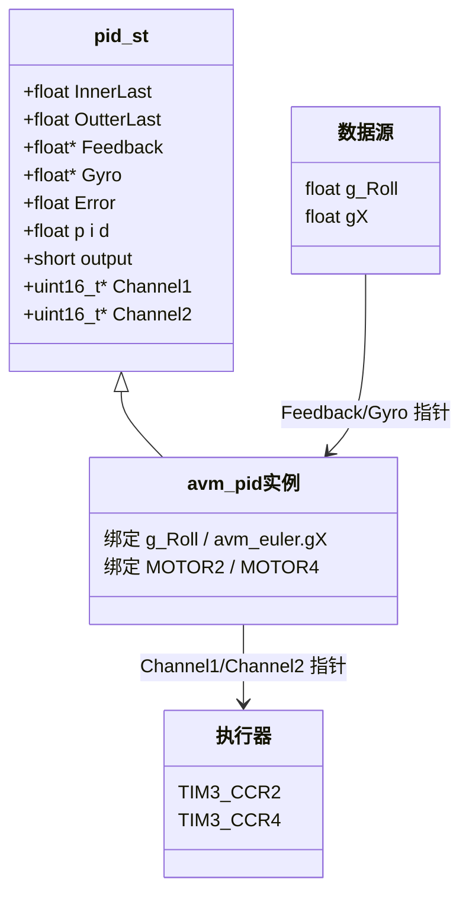

# Avem 源码详解 05：串级 PID

> **涉及文件**：
> - `libs/module/avm_pid.c`（104 行）—— `pid_SingleAxis()` 全部控制逻辑
> - `libs/module/avm_pid.h`（69 行）—— 参数宏与运行时结构体
> - `docs/README.md` —— 作者自己的调参长文（工程内原始资料）

四轴是非线性对象（电压→转速非线性、升力∝转速²），单级 PID 能飞但不好飞。
Avem 用**角度外环 PID + 角速度内环 PD** 的串级结构：外环管"稳"（把姿态角
拉回目标），内环管"快"（让角速度跟得上期望）——这是现代飞控控角的标准答案。

---

## 1. 结构体：pid_st 的"接线板"设计

### 1.1 定义与实例绑定（libs/module/avm_pid.h 47~59 行、avm_pid.c 42~49 行，逐字摘录）

```c
typedef struct {
    float InnerLast;
    float OutterLast;
    float *Feedback;
    float *Gyro;
    float Error;
    float p;
    float i;
    float d;
    short output;
    __IO uint16_t *Channel1;
    __IO uint16_t *Channel2;
} pid_st, *pid_pst;
```

```c
pid_st avm_pid = {
    .InnerLast  = 0,
    .OutterLast = 0,
    .Feedback   = &g_Roll,
    .Channel1   = &MOTOR2,
    .Channel2   = &MOTOR4,
    .Gyro       = &avm_euler.gX,
};
```

**设计意图**：指针成员把"传感器数据源"与"执行器输出端"在编译期绑死，
控制算法零耦合——想加 Pitch 轴，再实例化一份指向 `&g_Pitch`、
`&avm_euler.gY`、`&MOTOR1/&MOTOR3` 即可，算法一行不改。

| 成员 | 类型 | 绑定到 | 物理意义 |
| --- | --- | --- | --- |
| `Feedback` | float* | `g_Roll`（`avm_mpu6050.c` 161 行） | 姿态解算输出的横滚角（度） |
| `Gyro` | float* | `avm_euler.gX` | 陀螺 X 轴角速度——Roll 轴的转动由 X 轴角速度描述 |
| `Channel1/2` | __IO uint16_t* | `TIM3->CCR2 / CCR4`（MOTOR2/MOTOR4） | 本轴对角两颗电机 |
| `InnerLast` | float | 上周期角速度 | 内环 D 的后向差分记忆 |
| `OutterLast` | float | 上周期角度 | 外环 D 的后向差分记忆 |
| `p/i/d` | float | 中间量 | `p` 被复用为内环比例项（见 3.2 节） |
| `output` | short | — | 外环阶段=期望角速度；内环阶段=PWM 增量（复用） |

## 2. 参数表（libs/module/avm_pid.h 20~37 行）

| 宏 | 值 | 环 | 作用 | 过大/过小的表现 |
| --- | --- | --- | --- | --- |
| `OUTTER_LOOP_KP` | 3 | 外环 | 角度误差→期望角速度 | 过大：打舵回中震荡；过小：回平迟钝 |
| `OUTTER_LOOP_KI` | 1 | 外环 | 消除重心偏差的稳态倾斜 | 过大：低频摆动 |
| `OUTTER_LOOP_KD` | 0.3f | 外环 | 阻尼角度变化 | 过大：对加速度噪声敏感 |
| `INNER_LOOP_KP` | 1 | 内环 | 角速度误差→PWM 增量 | 过大：手扶机身有"硬邦邦"的抽动 |
| `INNER_LOOP_KI` | 0 | 内环 | **刻意为 0**：角速度环要快，不需要积分 | — |
| `INNER_LOOP_KD` | 0.3f | 内环 | 抑制角速度突变（阻尼） | 过大：混控抖动 |
| `PID_IMAX/IMIN` | ±30 | 外环 | 积分限幅（anti-windup） | 失效则起飞瞬间猛烈修正 |
| `SUM_ERRO_MAX/MIN` | ±900 | — | 预留旧参数，当前未引用 | — |

单位口径：角度误差是"度"，输出直接以 short 计数加到 CCR 上——参数量纲
由作者整体配套（1° 误差 × KP 3 = 3 单位期望角速度，再乘内环 KP 1 = 3 个
CCR 计数 ≈ 1.67µs 脉宽变化）。

## 3. pid_SingleAxis 逐段精读

### 3.1 外环（角度环）（libs/module/avm_pid.c 56~73 行，逐字摘录）

```c
void pid_SingleAxis(pid_pst temp, float setPoint) {
    /* ---- 外环（角度环）---- */
    temp->Error = *temp->Feedback - setPoint;      // 误差 = 实际角度 - 目标角度
//Outter Loop PID
    /* 积分累积误差，并做积分限幅（anti-windup 抗饱和）：
     * 若不限幅，起飞前长时间有静差会让积分爆表，起飞瞬间猛烈修正（俗称积分饱和） */
    temp->i += temp->Error;
    if (temp->i > PID_IMAX)
		temp->i = PID_IMAX;
    else if (temp->i < PID_IMIN)
		temp->i = PID_IMIN;

    /* 微分项用"本次角度 - 上次角度"的后向差分近似（不用真实导数，抗噪声） */
    temp->d = *temp->Feedback - temp->OutterLast;

    /* 外环输出 = 期望的角速度修正量（Kp/Ki/Kd 是外环三参数） */
    temp->output = (short)(OUTTER_LOOP_KP * (temp->Error) + OUTTER_LOOP_KI * temp->i + OUTTER_LOOP_KD * temp->d);
    temp->OutterLast = *temp->Feedback; //Save Old Data
```

- **误差方向**：`实际 - 目标`。机体向右横滚（g_Roll 增大）→ Error>0 →
  output>0 → Channel1(MOTOR2) 加、Channel2(MOTOR4) 减 → 产生反向滚转力矩。
- **积分限幅是"起飞保命"设计**：没有它，上电静置的倾斜会让 i 一路涨到
  爆表，起飞瞬间全力反向修正直接翻机。
- **后向差分**：`d = 本次角度 - 上次角度` 是导数的离散近似，比"用误差微分"
  少一个目标突变时的微分冲击（derivative kick）。
- **output 的双重身份**：外环阶段它是"期望角速度修正量"，下一行保存
  OutterLast 后，同一个 output 立刻作为内环输入——**串级结构的接口就是
  这一个 short 变量**。

### 3.2 内环（角速度环，纯 PD）（libs/module/avm_pid.c 75~82 行，逐字摘录）

```c
//Inner Loop PD
    /* ---- 内环（角速度环，纯 PD）---- */
    /* p 这里语义是"期望角速度 + 实测角速度 = 角速度误差"（作者复用变量名，注意别混淆）：
     * 期望角速度即外环输出 output，实测角速度取负号即 +Gyro 的效果 */
    temp->p = temp->output + *temp->Gyro;
    /* 内环 D：角速度的后向差分（本次 - 上次） */
    temp->d = *temp->Gyro - temp->InnerLast;
    /* 内环输出 = 最终 PWM 增量 */
    temp->output = (short)(INNER_LOOP_KP * temp->p + INNER_LOOP_KD * temp->d);
```

**最容易误读的一行**：`p = output + Gyro`。按"误差=期望-实际"应写
`output - Gyro`，这里写 `+` 等价于**符号整体取反**——只要 Channel1/Channel2
的加/减方向也随之取反（下一节确实是一加一减），闭环方向就是对的。
作者复用变量名 `p` 装角速度误差，读码时切勿把它当"比例增益"。

### 3.3 差动混控与限幅（libs/module/avm_pid.c 84~100 行，逐字摘录）

```c
    /* ---- 差动混控与限幅 ----
     * 通道1 加 output、通道2 减 output：同轴上两颗电机反向增减即产生滚转力矩。
     * 两次限幅把占空比钉死在 [THROTTLE_MIN, THROTTLE_MAX]，
     * 防止输出越界导致电机满转/停转失控。 */
    if (*temp->Channel1+temp->output > THROTTLE_MAX)
		*temp->Channel1 = THROTTLE_MAX;
    else if (*temp->Channel1+temp->output < THROTTLE_MIN)
		*temp->Channel1 = THROTTLE_MIN;
    else
		*temp->Channel1 += (short)temp->output;

    if (*temp->Channel2-temp->output > THROTTLE_MAX)
		*temp->Channel2 = THROTTLE_MAX;
    else if
		(*temp->Channel2-temp->output < THROTTLE_MIN) *temp->Channel2 = THROTTLE_MIN;
    else
		*temp->Channel2 -= (short)temp->output;

    /* 保存本次角速度，供下一周期内环 D 项做差分 */
    temp->InnerLast = *temp->Gyro;
```

**混控公式**（推导）：

```
CCR(MOTOR2) = clamp(CCR2 + output, 1620, 3600)
CCR(MOTOR4) = clamp(CCR2 - output, 1620, 3600)     （注意 else 分支才 +=/-=）
```

对角两电机一升一降 → 反扭矩差 → 滚转力矩；总升力（两者之和）不变——
这就是"差动"的名字来源。限幅写在加减之前（先判溢出），保证 **CCR 永远
在电调行程内**，电机永远不会满转/停转。

> 96~98 行的 `else if` 换行写法是原作者的格式痕迹（条件在下一行），
> 逻辑与第一个 if 对称。仅记录格式，不改代码。

## 4. 执行流与数据流





闭环在最后一段合拢：电机差速→机体滚转→g_Roll 变化→下一周期误差缩小。
外环与内环由同一个 `output` 变量串联（先后复用），这是 3.1 节讲过的
"串级接口就是这一个 short"。

## 5. 执行时序（一次 '$' 请求内）





## 5. 计算时序与量化

一次 `pid_SingleAxis` 的计算量：约 10 次浮点乘加 + 2 次 clamp 分支 +
2 次 16 位寄存器写。Cortex-M3 无 FPU，float 走软件库，单次约几 µs
（-O0 下更多）——相对 50Hz PWM 周期 20ms 余量巨大，控制瓶颈在 I2C 读数
（12 趟事务约 1~2ms，见 03 篇）而非 PID。

周期记忆链：

| 变量 | 本周期写入 | 下周期被谁读 |
| --- | --- | --- |
| `OutterLast` | 73 行 | 外环 D（69 行） |
| `InnerLast` | 103 行 | 内环 D（80 行） |
| `i` | 62 行累加 | 下周期继续累加 |

三个记忆都只在**被调用时**演化——调用频率即控制频率（上位机 '$' 频率）。

## 6. 陷阱与实测建议

- **调参顺序**（作者 docs/README.md 的完整版经验）：先内环后外环——
  ① 角度外环先注释掉、打舵量直接当内环期望（ACRO 手感）调内环 P；
  ② 加内环 D 抑制回中震荡；③ 可选小 I；④ 再启用角度外环只调 KP。
  本工程setPoint 固定 0（`avm_uart.c` 66 行 `pid_SingleAxis(&avm_pid, 0)`），
  没有遥控通道输入，"打舵实验"要自己注入 setPoint。
- **`i` 无掉电/降落复位**：炸机后静止捡起，外环积分还残留，再次上机会
  短时间"歪着修正"——工程级飞控会做落地产物清零或遥测触发复位。
- **单轴实现**：只有 Roll 轴实例。Pitch/Yaw 要飞起来必须补两份实例与
  混控矩阵（MOTOR1~MOTOR4 全用上）——这是本代码最值得做的练习。
- **(short) 截断**：output 超 ±32767 会回卷，理论上 KP 组合极端时可能触发；
  CCR 限幅兜底了通道值，但 output 本身没有限幅，扩展时留意。
- **方向性自检**：手动机体向右倾，看 CCR2 应增、CCR4 应减（文本帧直接
  可读）；反了就是 `p = output + Gyro` 符号与电机对不匹配，先查接线序。
- **读码路径**：[04-姿态解算.md](04-姿态解算.md)（Feedback 从哪来）→ 本文
  （误差怎么变增量）→ [06-电机PWM混控.md](06-电机PWM混控.md)（CCR 怎么变转速）。

> KB 逐函数精读：[libs_module_avm_pid.md](../../../05-学习笔记与知识库/Knowledge-Base/avem/libs_module_avm_pid.md)
