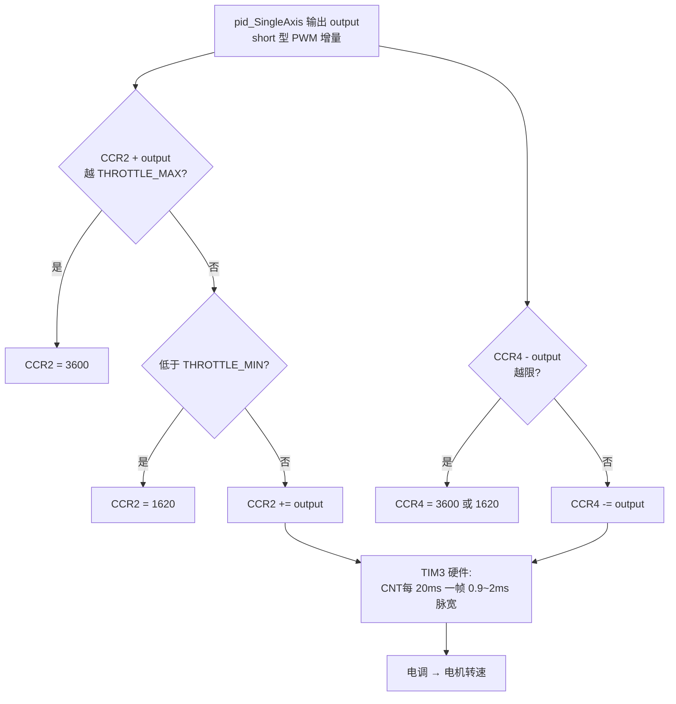
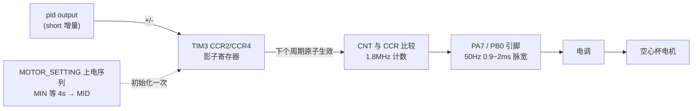

# Avem 源码详解 06：电机 PWM 混控

> **涉及文件**：
> - `libs/module/avm_motor.c`（92 行）—— TIM3 四通道 PWM 寄存器级配置
> - `libs/module/avm_motor.h`（76 行）—— 电机宏、油门界限、上电序列宏
> - `libs/module/avm_pid.c` 84~100 行 —— 混控公式的消费端（05 篇已精读）

从 `MOTOR2 = 某个数` 到电机转动，中间是 STM32 定时器 PWM 的完整配置链。
本文把 TIM3 的 PSC/ARR/CCMR/CCER/CR1 五组寄存器逐一讲透，并给出
"油门+姿态"混控公式的完整推导。

---

## 1. PWM 三要素与频率推导

| 寄存器 | 名字 | 本工程值 | 作用 |
| --- | --- | --- | --- |
| PSC | 预分频 | 39（写 40-1） | 72MHz/(39+1) = **1.8MHz** 计数时钟 |
| ARR | 自动重装 | 35999（写 36000-1） | 每 36000 计数一个周期 → **50Hz**（20ms） |
| CCRx | 比较值 | 1620~3600 | CNT<CCRx 输出有效电平 → 占空比 = CCR/36000 |

频率/占空比公式：

```
f_PWM   = 72MHz / ((PSC+1) × (ARR+1)) = 72e6 / (40 × 36000) = 50 Hz
占空比  = CCR / (ARR+1)
高电平  = CCR / 1.8MHz  →  THROTTLE_MAX 3600 计数 = 2ms，MIN 1620 = 0.9ms
```

50Hz + 0.9~2ms 脉宽正是**普通舵机/电调协议**（俗称"油门行程 1000~2000µs"），
所有数值自洽。**50Hz 对四轴太慢**（每个周期只更新一次推力），现代飞控用
OneShot/DShot——Avem 用普通 PWM 是教学取舍。

## 2. motor_PWM_Init 逐段精读

### 2.1 模块包装（libs/module/avm_motor.c 26~37 行，逐字摘录）

```c
/* 电机模块的注册信息（模块池 [3]，init 时执行 MOTOR_SETTING 完成全部配置） */
avm_module_t avm_motor_module_st = {
    0,
    NULL,
    avm_motor_init,
    NULL,
    NULL
};

static unsigned char avm_motor_init(void *arg) {
    MOTOR_SETTING();     /* 宏展开：调 motor_PWM_Init 设定 PWM 频率（见 avm_motor.h） */
    return 0;
}
```

`MOTOR_SETTING()` 宏（`avm_motor.h` 52~67 行，**多行 `\` 续行宏，注释工程
禁止在其宏体内插注释**）展开后做三件事：

```c
motor_PWM_Init(36000,40);        // 1. 50Hz PWM 就绪
MOTOR_ALL = THROTTLE_MIN;        // 2. 四路 CCR = 1620（怠速位）
delay_ms(4000);                  // 3. 等电调自检（注意 24 位回卷，实际约 0.27s，见 02 篇）
MOTOR_ALL = THROTTLE_MID;        // 4. 置 1650 待命
```

这就是模拟电调的**油门行程确认流程**：先最低油门、听"哔"声确认、再给
待命位。`#else` 分支是"满油门上电"的行程校准流程（3s MAX + 8s MIN），
用 `MOTOR_NORMAL_STARTUP` 宏切换。

### 2.2 时钟与 GPIO（libs/module/avm_motor.c 46~65 行，逐字摘录）

```c
void motor_PWM_Init(unsigned short arr, unsigned short psc) {
    //RCC->APB1ENR |= 1<<1;       //TIM3 enable
    //RCC->APB2ENR |= 1<<2;       //GPIOA enable

    /* 1. 打开时钟：TIM3 在 APB1 总线，GPIOA/B 在 APB2 总线（不开时钟寄存器写不进去） */
    RCC->APB1ENR |= RCC_APB1ENR_TIM3EN;		//TIM3 Enable
    RCC->APB2ENR |= RCC_APB2ENR_IOPAEN;		//IO Port A Enable
    RCC->APB2ENR |= RCC_APB2ENR_IOPBEN;		//IO Port B for TIM3 Channel 3 and 4

    /* 2. GPIO 配置：CRL 每引脚 4 位，0xB = 复用推挽输出 50MHz（定时器接管引脚）。
     *    先清后置：PA6/PA7 的高 8 位清零再写 0xBB；PB0/PB1 同理写低 8 位 */
    GPIOA->CRL &= 0x00FFFFFF;   //Clean
    GPIOA->CRL |= 0xBB000000;   //复用推挽输出
    GPIOA->ODR |= 1<<7;			//CH2 GPIO Config
    GPIOA->ODR |= 1<<6;			//CH1 GPIO Config

    GPIOB->CRL &= 0xFFFFFF00;
    GPIOB->CRL |= 0x000000BB;
    GPIOB->ODR |= 1;
    GPIOB->ODR |= 1<<1;
```

- **总线归属**：TIM3 是 APB1 外设（36MHz 时钟域但定时器时钟×2=72MHz），
  GPIOA/B 是 APB2。STM32 外设操作前必须开对应 RCC 时钟位——忘开时钟是
  "寄存器写了没反应"的第一大原因。
- **CRL 布局**：每引脚 4 位（MODE[3:0]）。`0xB` = 1011 = 复用推挽输出 50MHz。
  `0xBB000000` 把 PA7（bits31:28）、PA6（bits27:24）配成 0xB；
  `0x000000BB` 把 PB1（bits7:4）、PB0（bits3:0）配成 0xB。
- **ODR 预置**：引脚交给定时器前的初始电平，写 1 让四路起始为高。

### 2.3 时基与通道模式（libs/module/avm_motor.c 67~92 行，逐字摘录）

```c
    /* 3. 时基：ARR/PSC 写入的都是"实际值-1"（寄存器从 0 开始计数） */
    TIM3->ARR = arr - 1;
    TIM3->PSC = psc - 1;

    /* 4. 捕获比较模式：OCxM=110 即 PWM 模式1（CNT<CCR 输出有效电平）；
     *    OCxPE=1 使能预装载（CCR 的修改在下个周期才生效，避免波形毛刺） */
    TIM3->CCMR1 |= 6<<4;    //CH1 Set OC1M[2:0]: PWM Mode
    TIM3->CCMR1 |= 1<<3;    //CH1 Set OC1PE: Enable
    TIM3->CCMR1 |= 6<<12;   //CH2 Set OC2M[2:0]: PWM Mode
    TIM3->CCMR1 |= 1<<11;   //CH2 Set OC2PE: Enable
    TIM3->CCMR2 |= 6<<4;    //CH3 Set OC3M[2:0]: PWM Mode
    TIM3->CCMR2 |= 1<<3;    //CH3
    TIM3->CCMR2 |= 6<<12;   //CH4
    TIM3->CCMR2 |= 1<<11;

    /* 5. CCER：使能 4 个通道的输出到引脚（bit0/4/8/12 = CC1E~CC4E） */
    TIM3->CCER |= 1;        //CH1 Output Enable
    TIM3->CCER |= 1<<4;     //CH2 Output Enable
    TIM3->CCER |= 1<<8;
    TIM3->CCER |= 1<<12;

    /* 6. 启动：ARPE=1 使 ARR 预装载（改频率也原子生效）；CEN=1 开始计数 */
    TIM3->CR1 = 0x80;       //APRE Enable
    TIM3->CR1 |= 1;         //Set CEN, Allow to Count
    //TIM1->BDTR |= 1<<15;  //高级定时器需要使能BDTR寄存器
}
```

位段账本（对照参考手册 TIMx_CCMR1/2）：

| 操作 | 位段 | 含义 |
| --- | --- | --- |
| `6<<4` | OC1M[2:0]=110 | CH1 PWM 模式 1：CNT<CCR 时输出有效 |
| `1<<3` | OC1PE=1 | CCR1 预装载使能——写 CCR 先进影子寄存器，**下个更新事件才生效** |
| `6<<12` / `1<<11` | OC2M/OC2PE | CH2 同上 |
| CCMR2 同构 | OC3/OC4 | CH3/CH4 |
| CCER bit0/4/8/12 | CCxE | 把通道输出接到引脚 |
| CR1 bit7=APRE | ARR 预装载 | 改 ARR 也走影子寄存器 |
| CR1 bit0=CEN | 计数使能 | 开始跑 |

**预装载（OCxPE）是这段配置的灵魂**：PID 每周期写 CCR，若不预装载，写
发生在 CNT 中途时当前周期波形会被撕裂（毛刺/超宽脉冲会让电调误判）。
预装载后新值在下个周期边界原子生效——**PWM 输出的无抖动更新**。

末行被注释的 `TIM1->BDTR`：TIM1/TIM8 是高级定时器，必须再置 MOE 位输出
才有效；TIM3 是通用定时器不需要——作者留注释是提醒通用性差异。

## 3. 混控公式：从 PID 输出到四轴姿态

### 3.1 四轴混控理论（完整版）

四轴 X 布局四电机产生的力矩方程：

```
MOTOR1(前右) MOTOR2(后右)
MOTOR4(前左) MOTOR3(后左)      （Naze32 布局，对角同向旋转）

Roll 力矩  ∝ (M4 + M1) - (M2 + M3)     左右差
Pitch 力矩 ∝ (M1 + M2) - (M3 + M4)     前后差
Yaw 力矩   ∝ (M1 + M3) - (M2 + M4)     对角反向旋转的反扭矩差
Thrust     ∝  M1 + M2 + M3 + M4        总升力
```

### 3.2 Avem 的简化实现（单轴两电机）

本版本只实现了 Roll 轴、只用 MOTOR2/MOTOR4（`avm_pid.c` 46~47 行绑定），
混控退化为**差动对**（见 `avm_pid.c` 88~100 行）：

```
CCR2 = clamp(CCR2 + output, THROTTLE_MIN, THROTTLE_MAX)
CCR4 = clamp(CCR4 - output, THROTTLE_MIN, THROTTLE_MAX)
```

推导物理效果：output>0 时 CCR2↑（右后电机加速）、CCR4↓（左前电机减速）
→ 右侧推力>左侧 → 机体向左滚转 → g_Roll 变化 → 下一周期 Error 减小 →
负反馈闭环。**总升力近似不变**（一升一降），姿态调节不干扰油门。



### 3.3 数据流（油门的旅程）



## 4. 寄存器配置时序表（量化）

| 步骤 | 代码位置 | 写入 | 生效时机 |
| --- | --- | --- | --- |
| 开时钟 | `avm_motor.c` 51~53 行 | APB1ENR/APB2ENR | 立即 |
| GPIO | 57~65 行 | CRL/ODR | 立即（引脚仍普通 IO） |
| 时基 | 68~69 行 | ARR=35999, PSC=39 | CEN 后 |
| 通道模式 | 73~80 行 | CCMR1/2 | 立即 |
| 通道使能 | 83~86 行 | CCER | 立即 |
| 启动 | 89~90 行 | CR1=0x81 | CEN 置位后第一个时钟沿开始计数 |

首帧 PWM 在 CEN 置位后 ≤20ms 内出现；`MOTOR_SETTING` 紧随其后把 CCR 写到
MIN——电机从上电到"待命"的完整时间线 = 配置（µs 级）+ 延时（宏内 4s 意图，
实际约 0.27s，见 02 篇回卷推导）。

## 5. 陷阱与实测建议

- **delay_ms(4000) 回卷**：见 02 篇。若电调没完成自检就收到 MID 油门，
  表现为上电后电机"抽一下"。稳妥做法是把宏里的 `delay_ms(4000)` 改成
  循环 `for(i=0;i<5;i++) delay_ms(1000);`（记录思路，不改代码）。
- **油门行程错位**：THROTTLE_MID=1650 只比 MIN 大 30 计数（≈17µs），
  待命位几乎贴地——起飞要在上位机侧注入正 setPoint 或直接改 CCR 基线。
- **PWM 模式 1 的极性**：CNT<CCR 输出"有效电平"，本配置有效电平=高。
  若电调要反相（少见），改 CCER 的 CCxP 位，别去改 CCR。
- **50Hz 的物理极限**：姿态环最快 50Hz 更新推力，且 I2C 读数要 1~2ms，
  控制带宽天然受限。练手可以，抗风不行——升级 OneShot（把 ARR 缩到
  2000、计数时钟不动即可得到 250Hz）是第一步。
- **示波器验收点**：PA7 上看到 20ms 周期、0.9ms 脉宽（MIN）即 TIM3 配置
  成功；发 '$' 命令后脉宽随 PID 输出变化即混控链路通。
- **读码路径**：[05-串级PID.md](05-串级PID.md)（output 从哪来）→ 本文
  （PWM 怎么产生）→ [07-链路通信与调参指南.md](07-链路通信与调参指南.md)
  （怎么从上位机看到效果）。

> KB 逐函数精读：[libs_module_avm_motor.md](../../../05-学习笔记与知识库/Knowledge-Base/avem/libs_module_avm_motor.md)
