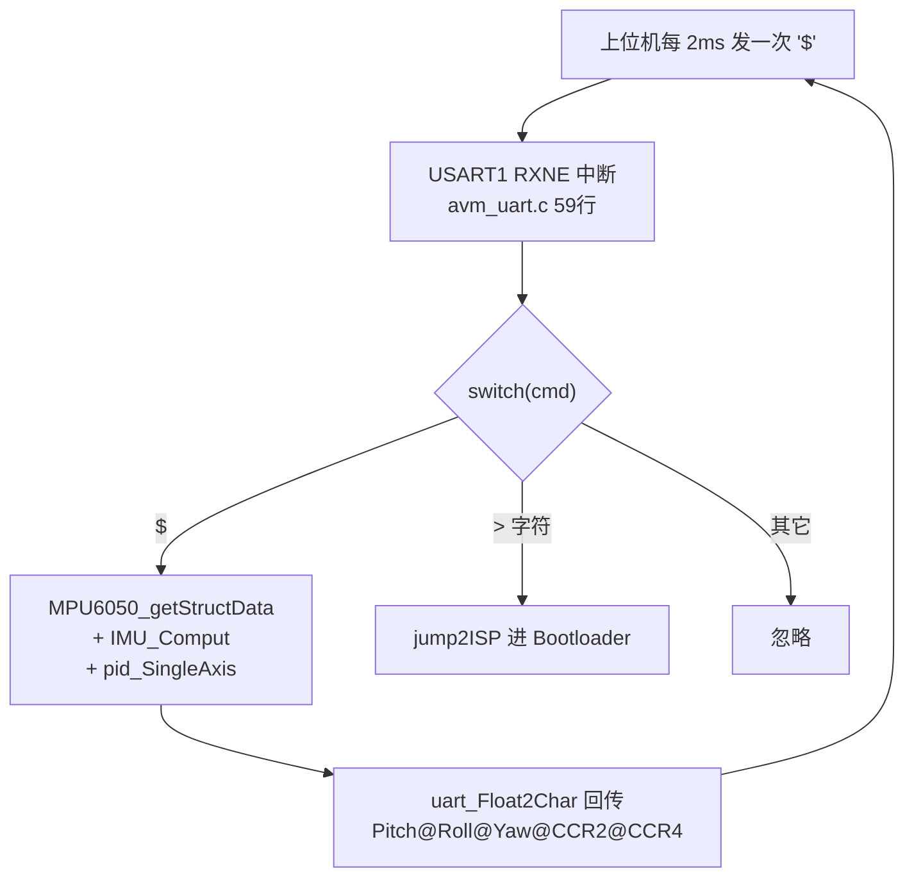
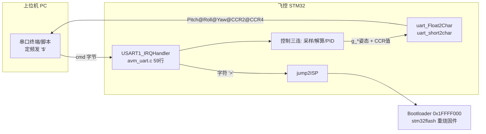

# Avem 源码详解 07：链路通信与调参指南

> **涉及文件**：
> - `libs/module/avm_uart.c`（177 行）—— USART1 驱动 + 协议处理 + 数值转字符串
> - `libs/module/avm_uart.h`（39 行）—— 协议约定（TOKEN/TOKEN_烧录）
> - `libs/module/avm_wifi.c`（62 行）/ `avm_wifi.h`（22 行）—— 预留 Wi-Fi 数传
> - `docs/README.md` —— 作者的串级 PID 调参长文（强烈建议对照阅读）

Avem 的链路层有个独特设计：**USART1 不只是调试口，它是控制循环的触发器**。
本文拆解串口协议、寄存器级波特率计算、无 printf 的浮点转字符串，最后给出
可落地的 PID 整定步骤与坑点清单。

---

## 1. 协议总览（avm_uart.h 22 行 + avm_uart.c 59~91 行）

| 命令（上位机→飞控） | 飞控动作 | 代码位置 |
| --- | --- | --- |
| `$`（TOKEN） | 采样→解算→PID 一整轮 + 回传文本帧 | `avm_uart.c` 63~82 行 |
| `>` | 进 Bootloader（jump2ISP）串口烧录 | `avm_uart.c` 83~86 行 |
| 其它字符 | 忽略 | 87~88 行 |

回传帧格式（ASCII 文本，`@` 分隔、`\n\r` 结尾）：

```
Pitch@Roll@Yaw@CCR2@CCR4\n\r
例：0.2531@-3.7560@12.5534@1620@1635
```

| 字段 | 来源 | 单位 |
| --- | --- | --- |
| Pitch/Roll/Yaw | `g_Pitch/g_Roll/g_Yaw`（IMU_Comput 输出） | 度 |
| CCR2/CCR4 | `*avm_pid.Channel1/2`（TIM3 比较寄存器值） | 计数（1620~3600） |



（图中 C 节点判断的字符为 `$` 与 `>`；上位机定频请求 = 控制频率，见 4.2 节。）

## 2. uart_init：寄存器级波特率计算

### 2.1 源码（libs/module/avm_uart.c 27~57 行，逐字摘录）

```c
void uart_init(unsigned int pclk2, unsigned int bound) {
    float temp;
    unsigned short mantissa;
    unsigned short fraction;
    temp = (float)(pclk2*1000000)/(bound*16);
    mantissa = temp;
    fraction = (temp - mantissa) * 16;
    mantissa <<= 4;
    mantissa += fraction;
    RCC->APB2ENR |= RCC_APB2ENR_IOPAEN;   //GPIOA Enable
    RCC->APB2ENR |= RCC_APB2ENR_USART1EN;  //USART1 Enable

    GPIOA->CRH &= 0xFFFFF00F;
    GPIOA->CRH |= 0x000008B0;

    RCC->APB2RSTR |= RCC_APB2RSTR_USART1RST;
    RCC->APB2RSTR &= ~RCC_APB2RSTR_USART1RST;

    USART1->BRR = mantissa;
    USART1->CR1 |= 0x200C;	//Set up UE, TE and RE

    USART1->CR1 |= 1<<8;	//PE Interrup Enable
    USART1->CR1 |= 1<<5;	//RX Not Empty Interrup Enable

    USART1->SR;     //Read Reg SR to Clean TXE and TE,(Reset value: 0x00C0)

	NVIC_EnableIRQ(USART1_IRQn);
	NVIC_SetPriority(USART1_IRQn, 3);

}
```

### 2.2 波特率推导（量化）

USART 分数波特率公式：`bound = f_clk / (16 × USARTDIV)`，即
`USARTDIV = f_clk / (16 × bound)`。BRR 寄存器把 USARTDIV 编码成
"整数部分<<4 | 小数部分×16"：

```
pclk2=72(MHz), bound=115200:
temp  = 72e6 / (115200×16) = 39.0625
mantissa = 39 → <<4 = 624
fraction = 0.0625×16 = 1
BRR = 624+1 = 625 = 0x271
校验: 72e6/(16×625) = 7200 = 115200 ✓
```

- `GPIOA->CRH |= 0x000008B0`：PA9（TX）=0xB 复用推挽输出、PA10（RX）=0x8
  输入上拉/下拉模式（CRH bits7:4=0xB 管 PA9，bits3:0=0x8 管 PA10）。
- `CR1 |= 0x200C`：bit13=UE（USART 使能）、bit3=TE、bit2=RE。
- `CR1 |= 1<<8 | 1<<5`：PE 中断 + **RXNE 接收非空中断**——后者是整个
  控制循环的触发源。
- `NVIC_SetPriority(USART1_IRQn, 3)`：抢占优先级 3（分组 4 下 0~15），
  Avem 只有这一个中断，数值不敏感。

## 3. USART1_IRQHandler：飞控的心跳

### 3.1 源码（libs/module/avm_uart.c 59~91 行，逐字摘录）

```c
void USART1_IRQHandler(void) {
	if(USART1->SR & USART_SR_RXNE) {
		const char cmd = USART1->DR;	// 读取串口接收寄存器来清除 RXNE 标志
		switch (cmd) {
			case TOKEN:
				MPU6050_getStructData(&avm_euler);
				IMU_Comput(avm_euler);
                pid_SingleAxis(&avm_pid, 0);

				uart_Float2Char(g_Pitch);
				uart_sendStr("@");

				uart_Float2Char(g_Roll);
				uart_sendStr("@");

				uart_Float2Char(g_Yaw);
                uart_sendStr("@");

                uart_short2char(*avm_pid.Channel1);
                uart_sendStr("@");

                uart_short2char(*avm_pid.Channel2);
				uart_sendStr("\n\r");
				break;
			case '>':	// Jump to bootloader
				uart_sendStr("Running bootloader...");
				jump2ISP();
				// NOTE: running bootloader
			default:	//其它按键
				break;
		}
	}
}
```

逐点解释：

1. **`读 DR 清 RXNE`**（61 行）：STM32 的 RXNE 标志靠"读 DR"清除，不读则
   中断风暴。
2. **控制链就在中断里**（64~66 行）：采样→解算→PID 三连。**在中断里跑
   1~2ms 的 I2C 事务是硬件设计大忌**（阻塞其它中断、栈深不可控），教学版
   为了"最短数据通路"这么写，工程化第一步就是把它搬进主循环/定时器。
3. **`case '>'` 无 break**（83~86 行）：jump2ISP() 不返回（直接跳 Bootloader），
   所以 fall-through 到 default 无实际影响——但这是靠"永不返回"保证的，
   若日后 jump2ISP 失败返回，`>` 会顺延进 default，行为未变，安全。
4. **setPoint 硬编码 0**（66 行）：目标姿态 = 水平悬停。没有遥控输入通道，
   "飞起来"需要自己加（如把上位机另一字符映射成 setPoint）。

## 4. 无 printf 的数值输出

### 4.1 整数版（libs/module/avm_uart.c 98~118 行，逐字摘录）

```c
void uart_short2char(short k) {
	char cache[] = "00000";
	int i = 4;
	unsigned short bit[] = {10000, 1000, 100, 10, 1};

	do {
		cache[i] += (char)(k / bit[i] % 10);
	} while(i--);
	uart_sendStr(cache);
}
```

技巧：预置字符串 `"00000"`，逐位 `cache[i] += 数字`——字符 '0'+n 直接得到
ASCII。`k/bit[i]%10` 是"除大数取余"逐位分解。注意 `k` 为负时结果是垃圾
（short 除法负数取余），所以 CCR 值（恒正）才用它；姿态角用下面的浮点版
（内部先取绝对值、补负号）。

### 4.2 浮点版 uart_Float2Char（libs/module/avm_uart.c 120~172 行）

流程：负数先发 `'-'` 并取反（128~131 行）→ 整数部分逐位逆序放入数组
（146~151 行）→ 数组内反转恢复顺序（152~157 行）→ 小数部分固定 4 位
（161~164 行）→ 整串发送。返回发送长度。**固定 4 位小数 + 无四舍五入**
（截断），看清姿态趋势够用，做定量测量时要心里有数。

### 4.3 发送原语（libs/module/avm_uart.c 93~96 行，逐字摘录）

```c
void uart_sendData(unsigned char data) {
    USART1->DR = data;
    while((USART1->SR & 0x40) == 0);
}
```

`SR bit6 = TC`（发送完成）：写 DR 后死等 TC。115200 下一字节约 87µs，
一帧 6 个数值约 40 字节 ≈ 3.5ms **阻塞发送**——中断里发这么久是第二个
"教学版原罪"，工程化应改环形缓冲 + TXE 中断。

## 5. Wi-Fi 数传（预留模块）

`avm_wifi.c`（62 行）是把 uart_init 的套路复制到 USART3（PB10/PB11，
APB1 36MHz）：

| 函数 | 行号 | 作用 |
| --- | --- | --- |
| `wifi_init` | 10~36 | USART3 波特率计算（`WIFI_PCLK2=36`！APB1 时钟不同于 USART1 的 72）+ GPIO + 中断使能 |
| `wifi_sendSingleByte` | 38~41 | 阻塞发 1 字节 |
| `wifi_sendData/sendCmd` | 43~52 | 发字符串 / 发字符串+CRLF（AT 指令格式） |
| `wifi_Config` | 54~62 | `AT+CWMODE=2`（AP 模式）→ `AT+CIPMUX=1`（多连接）→ `AT+CIPSERVER=1,80`（开 TCP 服务） |

**未挂进模块池**（`avm_core.c` 76~83 行没有它），当前工程不初始化——
扩展路径：把 `avm_wifi_module_st` 实例补上、注册进池、仿照 USART1 的
switch 协议解析 TCP 数据即可无线调参。

## 6. PID 整定步骤（落地版）

前提：桌面固定机架（或卸桨），上位机以**恒定频率**（建议 100~200Hz）发 '$'，
串口助手/脚本记录帧数据画曲线。

1. **验证链路**：上电等电调自检音 → 发 '$' → 应看到 Pitch/Roll 小幅波动
   （±1° 内）、CCR 在 MIN 附近。若 Roll 静止时也持续单方向漂 → 先做零偏
   标定（见 03 篇陷阱）。
2. **内环 P**（`INNER_LOOP_KP`，1 起）：手转机身模拟角速度，观察 CCR 响应。
   太小：松手后慢慢回来（"软"）；太大：静止时 CCR 高频抖动。
3. **内环 D**（`INNER_LOOP_KD`，0.3 起）：抑制"回中后震荡"。太大：手指
   拨动机身有"抽搐"感，混控后更明显。
4. **外环 P**（`OUTTER_LOOP_KP`，3 起）：人为把机体倾斜 20° 再放开，看
   g_Roll 曲线回 0 的速度与过冲。过冲大→加 KD 或减 KP。
5. **外环 I**（`OUTTER_LOOP_KI`，1 起）：静止放 1 分钟，若有固定小偏角
   （重心不正），I 把它磨掉。I 后仍偏 → 检查 IMAX 是否先饱和（±30）。
6. **混控验收**：两轴同时偏时看 CCR2/CCR4 是否一升一降对称；不对称查
   电机机械阻力。

**每改一个宏都要重新编译烧录**——Avem 没有在线调参存储，这是它与
MultiWii/Betaflight 协议级调参的最大差距（也是练习点：把 setPoint/KP/KI/KD
映射到上位机命令字）。

## 7. 数据流总图



## 8. 陷阱与实测建议

- **发 '$' 间隔不稳 = 解算失真**：halfT 假设 500Hz（04 篇），上位机用
  `sleep` 粗定时会造成姿态"忽快忽慢"，务必用硬件定时发送。
- **`>` 命令危险**：任何串口终端误敲 `>` 立即重启进 Bootloader（电机瞬间
  停转）——飞行中绝对不要开可交互终端直连。
- **波特率要匹配 72MHz**：BRR 计算依赖 pclk2=72；若改了时钟树（如 48MHz）
  而忘改 `avm_uart_conf`，通信全是乱码。
- **阻塞发送吃掉控制带宽**：一帧 3.5ms 阻塞 + I2C 1~2ms，单次 '$' 处理
  约 5ms → 上位机请求不要快于 200Hz，否则 RX 溢出丢字符（ORE 标志未处理）。
- **Wi-Fi 时钟陷阱**：USART3 在 APB1（36MHz），把 `WIFI_PCLK2` 抄成 72 会
  得到双倍波特率——抄寄存器配置代码时先核对外设挂哪条总线。
- **读码路径**：[05-串级PID.md](05-串级PID.md)（PID 内部）→ 本文（链路怎么
  驱动它）→ [06-电机PWM混控.md](06-电机PWM混控.md)（CCR 之后的执行器）。

> KB 逐函数精读：[libs_module_avm_uart.md](../../../05-学习笔记与知识库/Knowledge-Base/avem/libs_module_avm_uart.md) ·
> [libs_module_avm_wifi.md](../../../05-学习笔记与知识库/Knowledge-Base/avem/libs_module_avm_wifi.md) ·
> [libs_module_avm_core.md](../../../05-学习笔记与知识库/Knowledge-Base/avem/libs_module_avm_core.md)（jump2ISP）
